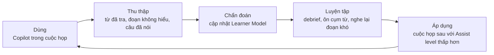
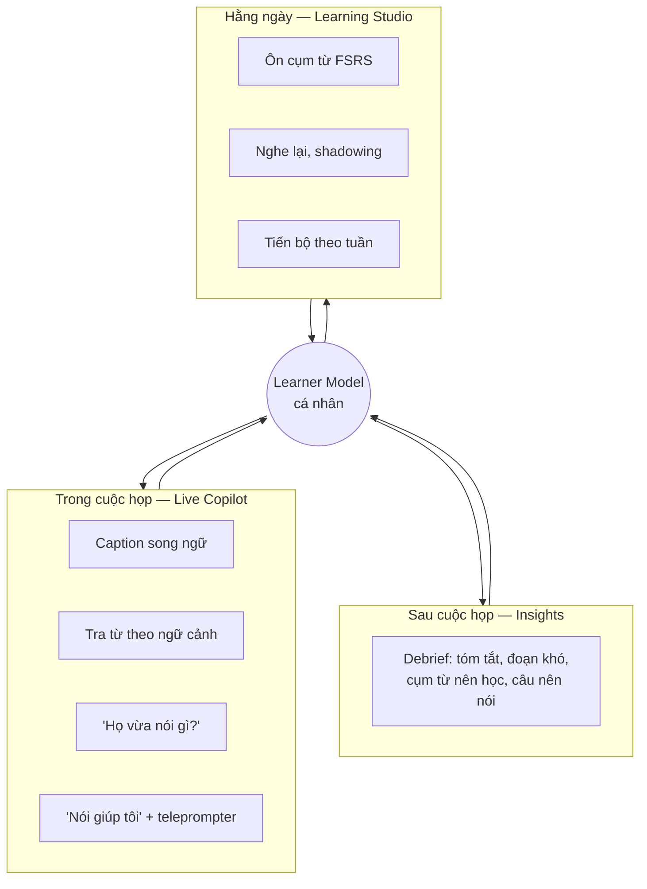
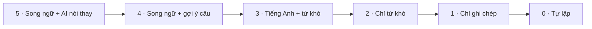
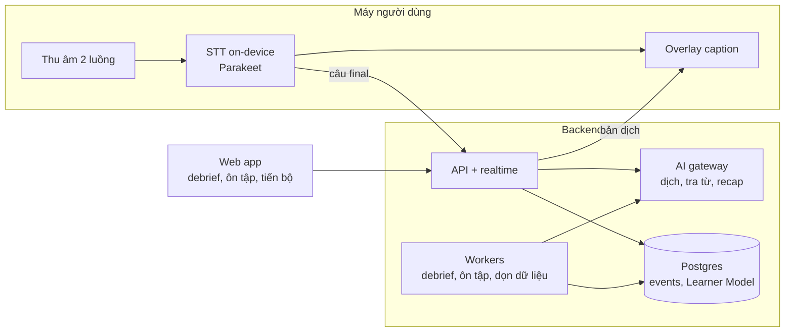

# Bức tranh toàn cảnh

CueLingo ngồi cạnh người dùng trong những cuộc giao tiếp thật bằng ngoại ngữ, giúp họ hiểu và nói được ngay lúc đó. Mỗi lần như vậy, nó học được người dùng còn yếu ở đâu và biến chính cuộc họp đó thành bài học. **Thước đo thành công không phải là người dùng phụ thuộc vào AI, mà là họ cần AI ít dần đi.**

## Một câu cho mỗi câu hỏi

| Câu hỏi          | Trả lời                                                                                                                                                      |
| ---------------- | ------------------------------------------------------------------------------------------------------------------------------------------------------------ |
| Vấn đề gì?       | Người đi làm (đặc biệt người Việt) đọc tiếng Anh được nhưng nghe và nói yếu. App học dạy nội dung chung chung; công cụ dịch thì tạo phụ thuộc                |
| Cho ai?          | Kỹ sư, PM, BA, sales làm việc với khách hàng/đồng nghiệp nước ngoài — chi tiết ở [Người dùng](./03-users.md)                                                 |
| Giải pháp?       | Một **Copilot** chạy trong mọi app họp + một **hệ thống học** dùng chính dữ liệu họp, cùng nối vào một **Learner Model** cá nhân                             |
| Khác gì đối thủ? | Đối thủ hoặc chỉ dịch (Meet, Teams, Zoom) hoặc chỉ dạy (Duolingo, ELSA). CueLingo nối hai thứ bằng dữ liệu giao tiếp thật và **Assist Dial** giảm dần hỗ trợ |
| Bắt đầu từ đâu?  | MVP: app desktop macOS, caption Anh → Việt, debrief sau họp, ôn cụm từ — [Phạm vi MVP](../02-product/03-mvp-scope.md)                                        |

## Vòng lặp lõi

Mọi tính năng đều phục vụ một vòng lặp. Copilot vừa là nơi hỗ trợ, vừa là nguồn dữ liệu, vừa là nơi đo tiến bộ.

## Sản phẩm nhìn từ người dùng

| Nhóm                        | Người dùng nhận được                                                        | Trang chi tiết                                          |
| --------------------------- | --------------------------------------------------------------------------- | ------------------------------------------------------- |
| Live Copilot                | Hiểu và nói được ngay trong họp, trên Zoom/Meet/Teams hay bất kỳ app nào    | [Bản đồ tính năng](../02-product/01-features.md)        |
| Insights                    | Biết mình đã hiểu bao nhiêu, bỏ lỡ gì, nên học gì sau mỗi cuộc họp          | [Hành trình](../02-product/02-user-journeys.md)         |
| Learning Studio             | Ôn đúng những cụm từ mình gặp trong công việc, đúng lúc sắp quên            | [Learner Model](../03-architecture/02-learner-model.md) |
| AI Coach, Planner (sau MVP) | Tập trước cuộc họp với persona khách hàng, chấm phát âm, lộ trình hằng ngày | [Lộ trình](../02-product/04-roadmap.md)                 |

## Assist Dial: tiến bộ nhìn thấy được

Mức hỗ trợ đi từ 5 (AI nói thay) xuống 0 (tự lập). AI chỉ **đề xuất** hạ mức khi Learner Model cho thấy người dùng đã sẵn sàng; người dùng luôn nâng lại được khi gặp cuộc họp khó.

MVP có mức 4, 3, 1. Chi tiết luật hạ mức ở [Learner Model](../03-architecture/02-learner-model.md#assist-dial).

## Hệ thống nhìn từ kỹ thuật

Client chỉ thu âm, hiển thị và cache. Logic học tập và AI nằm ở backend và các package dùng chung. STT chạy ngay trên máy để audio không phải rời máy.

| Phần            | Vai trò                                                    | Trang                                           |
| --------------- | ---------------------------------------------------------- | ----------------------------------------------- |
| Desktop app     | Bề mặt chính trong họp                                     | [Desktop](../04-modules/01-desktop/README.md)   |
| Web app         | Xem lại, debrief, ôn tập, quản lý dữ liệu                  | [Web](../04-modules/02-web/README.md)           |
| API service     | REST + WebSocket, dịch realtime, Learner Model             | [API](../04-modules/03-api/README.md)           |
| Workers         | Debrief, tính lại Learner Model, TTS, dọn dữ liệu          | [Workers](../04-modules/04-workers/README.md)   |
| Shared packages | Contract, SDK, logic Learner Model, AI gateway, prompt, UI | [Packages](../04-modules/05-packages/README.md) |
| ML              | Benchmark và eval model/prompt                             | [ML](../04-modules/06-ml/README.md)             |

Chi tiết các mũi tên ở [Sơ đồ hệ thống](./04-system-overview.md) và [Luồng realtime](../03-architecture/01-realtime-pipeline.md).

## Những quyết định định hình sản phẩm

| Quyết định                                        | Lý do                                                             | Nguồn                                                                                                 |
| ------------------------------------------------- | ----------------------------------------------------------------- | ----------------------------------------------------------------------------------------------------- |
| Bắt đầu bằng desktop macOS, chạy trên mọi app họp | Không phụ thuộc host bật tính năng; đúng nơi người dùng họp       | [ADR-0002](../08-adr/0002-desktop-tauri-swift.md)                                                     |
| STT on-device (Parakeet), audio không rời máy     | WER tốt nhất trên dữ liệu họp, rẻ, riêng tư                       | [ADR-0003](../08-adr/0003-stt-on-device-first.md), [Benchmark](../07-research/02-benchmark-stt-mt.md) |
| Dịch bằng LLM qua một gateway                     | COMET ~85 so với ~76 của model dịch nhỏ; đổi model không sửa code | [ADR-0004](../08-adr/0004-translation-via-llm.md)                                                     |
| Event log là nguồn sự thật cho Learner Model      | Đổi thuật toán không mất dữ liệu                                  | [ADR-0005](../08-adr/0005-modular-monolith-postgres.md)                                               |
| Mặc định không lưu audio                          | Dữ liệu họp là dữ liệu nhạy cảm của doanh nghiệp                  | [ADR-0006](../08-adr/0006-no-audio-by-default.md)                                                     |

## Lộ trình một trang

| Giai đoạn                  | Trọng tâm                                                       | Cổng đi tiếp          |
| -------------------------- | --------------------------------------------------------------- | --------------------- |
| **1 · MVP** (tháng 1–3)    | Copilot macOS, caption, debrief, ôn cụm từ, Learner Model v1    | Debrief được dùng đều |
| **2 · Learn** (tháng 4–6)  | Windows, extension, Daily Mix, Speech Coach, Assist Dial đầy đủ | Assist level giảm dần |
| **3 · Coach** (tháng 7–12) | Mobile, roleplay persona, rehearsal, Planner                    | Retention D90 ổn định |
| **4 · Scale** (năm 2)      | Nhật/Hàn/Trung, B2B Enterprise, voice mode                      | —                     |

Chi tiết: [Lộ trình](../02-product/04-roadmap.md).

## Đọc tiếp

[Tầm nhìn & nguyên tắc](./02-vision.md) · [Người dùng](./03-users.md) · [Sơ đồ hệ thống](./04-system-overview.md) · [Thuật ngữ](./05-glossary.md)
