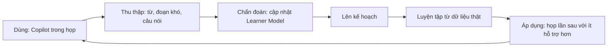

# Tầm nhìn & nguyên tắc

CueLingo là hệ thống giao tiếp và học ngoại ngữ lấy AI làm trung tâm: **hỗ trợ bạn giao tiếp ngay hôm nay, đồng thời dạy bạn để ngày mai cần hỗ trợ ít hơn.** Meeting Copilot chỉ là một module. Lõi thật sự là Learner Model cá nhân, được nuôi bằng dữ liệu giao tiếp thật.

## Vấn đề

- Người đi làm, đặc biệt là người Việt, thường đọc được tiếng Anh nhưng nghe và nói yếu. Khoảng cách giữa vốn từ thụ động (đọc hiểu được) và chủ động (nghe ra, nói ra được) rất lớn.
- App học hiện nay dạy nội dung chung chung, tách rời công việc thật. Người học dễ bỏ giữa chừng và khó áp dụng vào cuộc họp.
- Công cụ dịch realtime giải quyết được chuyện trước mắt, nhưng tạo ra phụ thuộc và người dùng không tiến bộ.

## Insight

Cuộc họp, email, tài liệu của chính người dùng là giáo trình tốt nhất: đúng ngữ cảnh, đúng người, đúng thuật ngữ, và có động lực ngay lập tức.

## Vòng lặp lõi

## Nguyên tắc sản phẩm

1. **Real-life first**: mọi bài học đều xuất phát từ một tình huống thật của người dùng.
2. **Assist to graduate**: mức hỗ trợ giảm dần theo năng lực. Mức độ phụ thuộc vào AI giảm xuống chính là thước đo thành công.
3. **One brain, many surfaces**: desktop, web, mobile, extension chỉ là giao diện. Tất cả cùng đọc và ghi vào một Learner Model.
4. **AI-native**: kế hoạch, nội dung, đánh giá và phản hồi đều do agent sinh ra và điều chỉnh liên tục.
5. **Privacy by design**: dữ liệu họp là dữ liệu nhạy cảm của doanh nghiệp. Người dùng sở hữu, kiểm soát và xoá được.

## Người dùng đầu tiên

Kỹ sư, PM, BA trong ngành phần mềm hoặc outsourcing tại Việt Nam, họp tiếng Anh hằng tuần, đọc tài liệu tốt nhưng nghe và nói chưa tốt. Persona đầy đủ xem trong tài liệu phác thảo sản phẩm (Claude Docs, tab Phác thảo).
