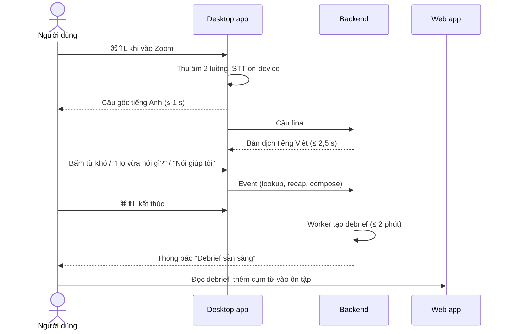
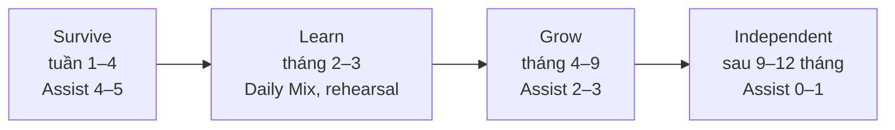

# Hành trình người dùng

Ba góc nhìn, từ ngắn đến dài: **một cuộc họp** (MVP), **một ngày**, **một năm**. Cột "Module" trỏ tới nơi hiện thực hoá từng bước.

## Một cuộc họp (MVP)

| #   | Bước     | Người dùng thấy                                                       | Module                                                                                                                                           |
| --- | -------- | --------------------------------------------------------------------- | ------------------------------------------------------------------------------------------------------------------------------------------------ |
| 1   | Bắt đầu  | Phím tắt hoặc menu bar → popup nhỏ chọn glossary, Assist level        | [tauri-core](../04-modules/01-desktop/tauri-core.md), [session-controller](../04-modules/01-desktop/session-controller.md)                       |
| 2   | Nghe     | Overlay: câu gốc hiện dần, bản dịch theo sau, từ khó gạch chân        | [overlay](../04-modules/01-desktop/overlay.md), [local-stt](../04-modules/01-desktop/local-stt.md), [realtime](../04-modules/03-api/realtime.md) |
| 3   | Bí       | Tra từ, "Họ vừa nói gì?", "Nói giúp tôi"                              | [quick-assist](../04-modules/01-desktop/quick-assist.md), [assist](../04-modules/03-api/assist.md)                                               |
| 4   | Kết thúc | Overlay đóng, "Đang chuẩn bị debrief…"                                | [sessions](../04-modules/03-api/sessions.md), [debrief-job](../04-modules/04-workers/debrief-job.md)                                             |
| 5   | Debrief  | Tóm tắt + action items, % hiểu, đoạn khó, cụm từ nên học, câu nên nói | [web/debrief](../04-modules/02-web/debrief.md)                                                                                                   |
| 6   | Ôn       | Thẻ có câu gốc + audio, 3 dạng bài                                    | [web/review](../04-modules/02-web/review.md), [phrases-review](../04-modules/03-api/phrases-review.md)                                           |

## Một ngày (sau MVP)

| Giờ      | Khoảnh khắc                                                                                  | Nền tảng         | Giai đoạn        |
| -------- | -------------------------------------------------------------------------------------------- | ---------------- | ---------------- |
| 08:00    | Brief buổi sáng: "14h họp với Acme. Tập 8 phút với persona John?" + 5 cụm từ có thể cần      | Mobile           | Coach            |
| 08:30    | Daily Mix 10 phút: ôn SRS, nghe lại 2 đoạn khó hôm qua, shadowing 3 câu                      | Mobile / web     | Learn            |
| 13:50    | Rehearsal: roleplay 5 phút, AI hỏi đúng kiểu John hay hỏi                                    | Desktop / mobile | Coach            |
| 14:00    | Cuộc họp với Copilot ở Assist 3                                                              | Desktop          | **MVP**          |
| 14:45    | Debrief: "Hiểu 82% (tuần trước 74%). Bỏ lỡ 3 đoạn, 5 cụm mới, 2 câu có thể nói tự nhiên hơn" | Desktop / web    | **MVP**          |
| 16:00    | Viết email follow-up, Writing Copilot gợi ý và dùng lại cụm vừa học                          | Extension        | Learn            |
| 18:30    | Podcast cá nhân 8 phút kể lại cuộc họp bằng tiếng Anh, đúng tốc độ đang luyện                | Mobile           | Scale            |
| Chủ nhật | Báo cáo tuần: tiến bộ, dependence index, đề xuất hạ Assist level với Acme                    | Web              | **MVP** (cơ bản) |

## Một năm

| Giai đoạn   | Trạng thái người dùng                                     | Sản phẩm cần mạnh ở                         |
| ----------- | --------------------------------------------------------- | ------------------------------------------- |
| Survive     | Dùng mức hỗ trợ cao, chủ yếu cần vượt qua cuộc họp        | Copilot ổn định, debrief, xây Learner Model |
| Learn       | Bắt đầu ôn hằng ngày, tập trước họp                       | Planner, Learning Studio, caption fading    |
| Grow        | Tự tin hơn khi nói, cần ít gợi ý                          | Roleplay, phát âm sâu, thuyết trình         |
| Independent | Hầu như tự lập, chỉ bật khi họp khó hoặc học ngôn ngữ mới | Ngôn ngữ thứ hai, ghi chép                  |

Mốc thời gian là ước lượng, sẽ chỉnh theo dữ liệu beta.
