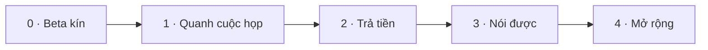

# Lộ trình

**Hướng đi: B2C trước** (chốt 2026-11-02). Mục tiêu là người dùng cá nhân thấy giá trị mỗi ngày làm việc, rồi trả tiền. Mỗi đợt có một lời hứa với người dùng và một cổng đo được; đợt sau chỉ mở khi đợt trước qua cổng. Ngưỡng của cổng là **giả định ban đầu**, chốt lại bằng số liệu beta.

Task chi tiết, chủ và phụ thuộc: [Backlog](./06-backlog.md#kế-hoạch-hoàn-thiện-theo-đợt-b2c-first). Trạng thái từng tính năng: [Bản đồ tính năng](./01-features.md).

## Các đợt

| Đợt                    | Lời hứa với người dùng                                 | Nội dung                                                                                                                                                                                                            | Cổng để đi tiếp                                                               |
| ---------------------- | ------------------------------------------------------ | ------------------------------------------------------------------------------------------------------------------------------------------------------------------------------------------------------------------- | ----------------------------------------------------------------------------- |
| **0 · Beta kín**       | Hiểu được cuộc họp hôm nay                             | Đóng việc dở để người khác dùng được: ký + cập nhật app, đăng nhập production, chạy thật Zoom/Meet, nhãn người nói, nối thuật ngữ vào nhận dạng, đo kích hoạt và giữ chân, họp tiếng Việt (đã có mã, chờ chạy thật) | H1–H3 đạt với 30–50 người; p95 độ trễ đo thật; D7 ≥ 30%                       |
| **1 · Quanh cuộc họp** | Vào họp tự tin, ra họp có việc để làm                  | Briefing trước họp, follow-up sau họp, chỉ số độc lập hằng tuần, nhắc ôn qua thông báo                                                                                                                              | ≥ 50% cuộc họp có mở briefing hoặc follow-up; D30 ≥ 15%                       |
| **2 · Trả tiền**       | Dùng đều thì trả tiền xứng đáng                        | Gói Free/Pro, quota, thanh toán, trang giá, trang chủ công khai, pháp lý                                                                                                                                            | Chuyển đổi free → trả phí ≥ 3%; chi phí AI/giờ họp thấp hơn doanh thu/giờ họp |
| **3 · Nói được**       | Tuần này bạn cần AI ít hơn                             | Nghe lại đoạn khó, Speech Coach, shadowing, Assist Dial đầy đủ, gợi ý câu trả lời, Daily Mix                                                                                                                        | Assist level giảm thật ở ≥ 30% người dùng sau 6 tuần                          |
| **4 · Mở rộng**        | Có mặt ở đúng nơi và đúng ngôn ngữ người dùng làm việc | Windows, mobile, extension, roleplay, ngôn ngữ thêm, voice mode, B2B                                                                                                                                                | Điều kiện mở từng hướng ở bảng cuối trang                                     |

## Vì sao thứ tự này

| Quyết định                                     | Lý do                                                                                                                                                                          |
| ---------------------------------------------- | ------------------------------------------------------------------------------------------------------------------------------------------------------------------------------ |
| Đợt 1 (trước và sau họp) đứng trước thanh toán | Người dùng cá nhân chỉ trả tiền khi dùng đều. Briefing và follow-up kéo họ vào app mỗi ngày làm việc, không chỉ khi có họp, và dùng lại lịch, glossary, debrief, compose đã có |
| Chỉ số độc lập làm số đo chính                 | Đúng triết lý "cần AI ít dần đi"; là chứng cứ giá trị để bán gói Pro                                                                                                           |
| Thanh toán sau khi có số beta                  | Giá và giới hạn gói Free phụ thuộc chi phí AI/giờ họp (H5), chưa đo                                                                                                            |
| Nghe lại đoạn khó và Speech Coach ở Đợt 3      | Cùng gốc audio, nhạy cảm về riêng tư; làm khi đã có niềm tin và điều khoản rõ                                                                                                  |
| Voice mode xếp cuối                            | Đi ngược mục tiêu giảm phụ thuộc; chỉ mở khi số liệu chứng minh người dùng đang giảm phụ thuộc                                                                                 |
| Windows, B2B lùi xuống Đợt 4                   | Cá nhân chưa chứng minh được giá trị thì chưa nên chia nguồn lực. Xem điều kiện mở bên dưới                                                                                    |

## Điều kiện mở các hướng ở Đợt 4

| Hướng                                                        | Điều kiện mở                                                                                                                                                                                                   |
| ------------------------------------------------------------ | -------------------------------------------------------------------------------------------------------------------------------------------------------------------------------------------------------------- |
| Windows                                                      | Cổng Đợt 2 qua và có tín hiệu từ danh sách chờ/phản hồi; hoặc macOS-only là nút thắt tăng trưởng                                                                                                               |
| Mobile, extension đọc/viết, roleplay, tutor                  | Cổng Đợt 3 qua                                                                                                                                                                                                 |
| Ngôn ngữ thứ ba                                              | Tiếng Nhật, Hàn, Trung đã có qua đám mây ([ADR 0016](../08-adr/0016-cloud-stt-for-japanese-korean-chinese.md)); thêm ngôn ngữ nữa khi có nhu cầu và bộ đánh giá ([ADR 0013](../08-adr/0013-multi-language.md)) |
| Voice mode                                                   | Chỉ số độc lập chứng minh người dùng giảm phụ thuộc                                                                                                                                                            |
| B2B (Team, glossary công ty, dashboard L&D, SSO, on-premise) | Có ≥ 3 công ty chủ động hỏi bản team, hoặc chuyển đổi cá nhân chạm trần                                                                                                                                        |

## Lịch sử: kế hoạch 12 tuần của MVP

MVP đã chạy được từ đầu đến cuối (M1–M4); phần còn lại để ra beta nằm ở Đợt 0. Kế hoạch tuần gốc giữ làm tham chiếu:

| Tuần  | Hạng mục                                        | Phần/module                                                                   |
| ----- | ----------------------------------------------- | ----------------------------------------------------------------------------- |
| 1–2   | Benchmark streaming, chốt STT/LLM, dựng bộ test | ml/bench, ml/eval                                                             |
| 1–4   | Thu audio + overlay                             | desktop/audio-capture, desktop/local-stt, desktop/tauri-core, desktop/overlay |
| 2–5   | Realtime API + dịch                             | api/realtime, packages/ai-gateway, packages/prompts                           |
| 5–6   | Quick Assist                                    | desktop/quick-assist, api/assist                                              |
| 5–8   | Debrief                                         | workers/debrief-job, web/debrief                                              |
| 7–9   | Phrase Bank + ôn tập                            | api/phrases-review, web/review, packages/learner-model                        |
| 8–10  | Learner Model + tiến bộ                         | api/learner, api/progress, web/progress                                       |
| 9–10  | Onboarding + quyền riêng tư                     | desktop/onboarding, api/privacy, workers/retention                            |
| 10–12 | Kiểm thử, tối ưu độ trễ, closed beta            | toàn bộ                                                                       |

## Câu hỏi mở

- [x] Tên sản phẩm: CueLingo (cần kiểm tra domain và nhãn hiệu)
- [x] B2C trước hay pilot ngay với một công ty outsourcing: **B2C trước** (2026-11-02). B2B mở lại theo điều kiện ở bảng trên
- [ ] Chỉ tiếng Anh hay Anh + Nhật: Nhật đã làm ngôn ngữ thứ hai (P3); còn chốt khi nào bật cho người dùng, theo eval
- [ ] Hỗ trợ tối thiểu macOS 13 hay 14.4 (ảnh hưởng độ phủ người dùng B2C)
- [ ] Giá và giới hạn gói Free: chốt sau khi đo chi phí AI/giờ họp trong beta
- [ ] Nhà cung cấp thanh toán: cần ADR trước Đợt 2
- [ ] Kênh phân phối B2C đầu tiên (cộng đồng dev Việt, danh sách chờ, giới thiệu)
- [ ] Hết quota giữa cuộc họp thì làm gì (không cắt đột ngột)
