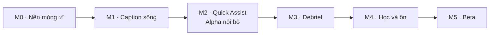

# Backlog và mốc giao hàng

Trang này biến [bản đồ tính năng](./01-features.md), [phạm vi MVP](./03-mvp-scope.md) và [lộ trình](./04-roadmap.md) thành **mốc dùng được** (M1…M5) và **task có chủ** để chia cho Claude và Codex. Nguyên tắc: mỗi mốc kết thúc bằng một thứ người dùng **chạy và thấy được**, không phải một lớp hạ tầng.

## Cách đọc

| Cột       | Ý nghĩa                                                                                                                                                    |
| --------- | ---------------------------------------------------------------------------------------------------------------------------------------------------------- |
| Chủ       | **C** = Claude (lead: native, realtime, AI, tích hợp, review) · **X** = Codex (làm theo brief trong worktree riêng) · **U** = người dùng phải làm/cung cấp |
| Cỡ        | S ≤ nửa ngày · M ≈ 1 ngày · L 2–3 ngày                                                                                                                     |
| Phụ thuộc | Task phải xong trước                                                                                                                                       |
| Brief     | Mỗi task **X** thành một brief `04-brief-*.md` (≤ 1 ngày, ≤ ~10 file) trước khi giao; Claude viết brief và review chéo                                     |

**Quy tắc chia việc.** Giao cho Codex: UI React/web, module CRUD sao chép từ module mẫu `glossary`, schema + client SDK, test, docs module. Giữ cho Claude: Swift/audio, pipeline realtime, prompt + gateway AI, migration nhạy cảm, tích hợp cuối. Mọi thứ Codex làm đều cần Claude cài sẵn dependency (Codex không có mạng) và review chéo.

## Các mốc

| Mốc                 | Người dùng làm được gì                                                                        | Ước lượng | Cổng                                                                                |
| ------------------- | --------------------------------------------------------------------------------------------- | --------- | ----------------------------------------------------------------------------------- |
| **M0** Nền móng     | (đã xong) API, auth, worker, web glossary, khung desktop                                      | —         | ✅                                                                                  |
| **M1** Caption sống | Mở app, bấm ⌘⇧L, thấy **caption tiếng Anh + bản dịch tiếng Việt** của cuộc họp đang diễn ra   | 3 tuần    | Chạy thật với Zoom/Meet: p95 câu gốc ≤ 1 s, dịch ≤ 2,5 s trong 30 phút, không crash |
| **M2** Quick Assist | Tra từ, hỏi "họ vừa nói gì?", gõ tiếng Việt → câu tiếng Anh. **Alpha nội bộ**                 | +2 tuần   | Bạn dùng thật trong 3 cuộc họp thật, ghi lại lỗi                                    |
| **M3** Debrief      | Sau họp mở web xem 5 khối debrief, nghe lại đoạn khó, lưu cụm từ                              | +2 tuần   | Debrief ≤ 2 phút sau họp, đủ 5 khối                                                 |
| **M4** Học và ôn    | Ôn cụm từ từ chính cuộc họp bằng FSRS; xem tiến bộ theo tuần                                  | +2 tuần   | Phiên ôn 5–10 phút, FSRS đúng lịch                                                  |
| **M5** Beta         | Onboarding, đăng nhập trong app, quyền riêng tư (xoá dữ liệu), cài đặt lưu bền, bản `.app` ký | +2 tuần   | 30–50 người dùng thử; H1–H3 đo được                                                 |

Ước lượng giả định Claude + Codex làm song song. **Thứ tự được chọn để sớm có sản phẩm dùng được**: M1 dùng STT on-device và dịch bằng LLM, bỏ qua mọi thứ chưa cần (đăng nhập trong app, lưu phiên) — M1 chạy được ngay với một API key LLM trong `.env`.

## M1 · Caption sống

Đường găng: thu âm hệ thống (Swift) → STT → dịch → overlay. Mọi thứ khác chờ xung quanh nó.

| ID    | Task                                                                                                                                              | Chủ | Phụ thuộc           | Cỡ  | Ghi chú                                                                                 |
| ----- | ------------------------------------------------------------------------------------------------------------------------------------------------- | --- | ------------------- | --- | --------------------------------------------------------------------------------------- |
| M1-01 | **Spike thu âm**: Swift package bắt âm thanh hệ thống (Core Audio Process Tap) + mic, ghi ra file WAV, đo độ trễ; xin quyền TCC                   | C   | —                   | M   | Rủi ro cao nhất; làm đầu tiên. Cần bạn bấm cấp quyền Micro/Audio Capture ở lần chạy đầu |
| M1-02 | **Cầu Swift ↔ Rust**: Swift CLI sidecar xuất PCM/JSON qua stdout; Rust spawn, đọc, phát event Tauri                                               | C   | M1-01               | M   | Quyết định sidecar vs FFI ghi vào ADR nếu khác scaffold                                 |
| M1-03 | **STT on-device**: FluidAudio + Parakeet-TDT, VAD, `transcript.partial/final` có timestamp từ                                                     | C   | M1-02               | L   | Tải model ~600 MB; chạy ngoài sandbox                                                   |
| M1-04 | **Hợp đồng realtime** `@cuelingo/shared` `ws.ts` (hello, segment.final, translation, error) + schema Zod + test                                   | X   | —                   | S   | Theo `04-realtime-pipeline.md`; chạy song song với M1-01                                |
| M1-05 | **ai-gateway**: task `translate` (Vercel AI SDK), timeout 3 s + dự phòng, prompt có phiên bản trong `@cuelingo/prompts`, eval nhỏ trong `ml/eval` | C   | —                   | M   | Cần **U**: một API key LLM (Anthropic/Google/OpenAI) trong `.env`                       |
| M1-06 | **api/realtime**: WebSocket Fastify, xác thực, nhận `segment.final`, dịch với 3 câu trước + glossary, trả `translation`                           | C   | M1-04, M1-05        | L   | Auth WS dùng session Better Auth; M1 cho phép token dev                                 |
| M1-07 | **core-sdk realtime client**: kết nối WS, đệm 60 s khi mất mạng, kết nối lại, kiểu theo `ws.ts`                                                   | X   | M1-04               | M   | Test với WS giả                                                                         |
| M1-08 | **session-controller (desktop)**: nối native event → WS → overlay; trạng thái phiên (idle/running/error); `useSession()`                          | X   | M1-02, M1-07        | M   | Chỉ gọi `native.*` và core-sdk                                                          |
| M1-09 | **Overlay hoàn thiện**: partial nhạt/final đậm, Assist level 4/3/1 đồng bộ main↔overlay (Rust phát event), cỡ chữ 14–24, sáng/tối, ghim           | X   | M1-08               | M   | Cần thêm event `settings` trong Rust: **C** thêm trước, **X** dùng                      |
| M1-10 | **Đo độ trễ end-to-end** + chạy thật với Zoom/Meet 30 phút; ghi số liệu vào docs                                                                  | C   | M1-03, M1-06, M1-09 | M   | Cổng M1                                                                                 |

## M2 · Quick Assist (Alpha nội bộ)

| ID    | Task                                                                                                             | Chủ | Phụ thuộc    | Cỡ  |
| ----- | ---------------------------------------------------------------------------------------------------------------- | --- | ------------ | --- |
| M2-01 | `api/assist`: `lookup` (tra từ theo ngữ cảnh), `recap` (60 s gần nhất), `compose` (VI → 2 câu EN); prompt + eval | C   | M1-05        | L   |
| M2-02 | Glossary cá nhân vào pipeline: gợi ý thuật ngữ cho STT (boost) và prompt dịch; chọn glossary trước họp           | C   | M1-06        | M   |
| M2-03 | `desktop/quick-assist` UI: popup tra từ (click từ trong overlay), ô "Họ vừa nói gì?", ô soạn câu + teleprompter  | X   | M2-01, M1-09 | L   |
| M2-04 | Phím tắt ⌘⇧W (recap) và ⌘⇧S (nói giúp) nối với UI; hotkey event đã có ở Rust                                     | X   | M2-03        | S   |
| M2-05 | Gắn nhãn người nói "Tôi" / "Speaker N" (tách luồng mic/system; diarization nhẹ cho system); đổi tên được         | C   | M1-03        | L   |
| M2-06 | Event học tập: `lookup`, `translation_expanded`, `recap_used`… vào `api/events` (append-only) + schema contract  | X   | M1-04        | M   |
| M2-07 | **Alpha nội bộ**: bạn dùng thật 3 cuộc họp; Claude gom lỗi, sửa, ghi vào review                                  | U+C | tất cả M2    | —   |

## M3 · Debrief

| ID    | Task                                                                                                              | Chủ | Phụ thuộc                  | Cỡ  |
| ----- | ----------------------------------------------------------------------------------------------------------------- | --- | -------------------------- | --- |
| M3-01 | Lưu phiên: `api/sessions` (tạo/kết thúc), lưu segments + events vào Postgres (bảng đã có), tắt lưu audio mặc định | C   | M1-06, M2-06               | M   |
| M3-02 | Đồng bộ desktop → API: client đăng nhập trong app (magic link → deep link `cuelingo://`), token trong Keychain    | C   | M3-01                      | L   |
| M3-03 | `workers/debrief-job`: tóm tắt, quyết định/việc cần làm, cụm từ khó, "câu bạn nói → câu nên nói"; prompt + eval   | C   | M3-01                      | L   |
| M3-04 | `web/debrief`: danh sách phiên + trang chi tiết 5 khối, transcript song ngữ, xuất Markdown                        | X   | M3-03 (hợp đồng DTO trước) | L   |
| M3-05 | Nghe lại đoạn khó 0,75x/1x, ẩn/hiện chữ (cần lưu audio đoạn ngắn có đồng ý)                                       | X   | M3-04                      | M   |
| M3-06 | Nút "Lưu cụm từ" từ debrief → Phrase Bank (API + UI)                                                              | X   | M3-04                      | S   |

## M4 · Học và ôn

| ID    | Task                                                                                                             | Chủ | Phụ thuộc   | Cỡ  |
| ----- | ---------------------------------------------------------------------------------------------------------------- | --- | ----------- | --- |
| M4-01 | `packages/learner-model`: lexicon tiếp nhận/sản xuất, cập nhật từ event, FSRS (thư viện có sẵn), test thuộc tính | C   | M2-06       | L   |
| M4-02 | `api/phrases-review`: Phrase Bank CRUD (copy `glossary`), hàng đợi ôn hôm nay, ghi `review_logs`                 | X   | M4-01 (DTO) | L   |
| M4-03 | `web/review`: phiên ôn 5–10 phút, 3 dạng bài (nhận diện, điền từ, nghe–gõ), có câu gốc + audio                   | X   | M4-02       | L   |
| M4-04 | `api/progress` + `web/progress`: % hiểu, số cụm, streak, chỉ số phụ thuộc theo tuần                              | X   | M4-01       | M   |
| M4-05 | Assist Dial gợi ý nâng/giảm mức từ dữ liệu thật (3 mức MVP)                                                      | C   | M4-01       | M   |
| M4-06 | Bài nghe đánh giá ban đầu (F1/US-02): 5 phút, ra mức nghe + Assist mặc định                                      | X   | M4-01       | M   |

## M5 · Beta

| ID    | Task                                                                                                             | Chủ | Phụ thuộc | Cỡ  |
| ----- | ---------------------------------------------------------------------------------------------------------------- | --- | --------- | --- |
| M5-01 | Onboarding thật: kiểm quyền TCC (micro, ghi màn hình) từ Rust/Swift thay cho `unknown`, hướng dẫn khi bị từ chối | C   | M1-01     | M   |
| M5-02 | Quyền riêng tư: xoá phiên + dữ liệu rút ra, xoá tài khoản, tắt lưu audio, `workers/retention` có storage thật    | C   | M3-01     | M   |
| M5-03 | `desktop/settings` lưu bền (store Tauri) + trang cài đặt web                                                     | X   | M1-09     | M   |
| M5-04 | Nhà cung cấp email production cho magic link, cookie domain cho web ↔ API, Google OAuth                          | C+U | —         | M   |
| M5-05 | Ký + notarize `.app`, tự cập nhật (Tauri updater), kênh phân phối beta                                           | C+U | —         | L   |
| M5-06 | Quan sát: log có cấu trúc, đo chi phí AI / giờ họp (H5), Sentry; tối ưu độ trễ và CPU/RAM phiên 2 giờ            | C   | M1-10     | L   |
| M5-07 | Closed beta: 30–50 người, form phản hồi, dashboard H1–H4                                                         | U+C | tất cả    | —   |

## Việc cần từ người dùng (U)

| Khi nào      | Việc                                                                                               |
| ------------ | -------------------------------------------------------------------------------------------------- |
| Trước M1-05  | Một API key LLM (nhà cung cấp tuỳ bạn) đặt vào `.env`. Khuyến nghị bắt đầu với một model rẻ, nhanh |
| M1-01        | Bấm cấp quyền Micro và Audio Capture/Screen Recording cho app khi macOS hỏi                        |
| M2-07, M5-07 | Dùng thật và báo lỗi                                                                               |
| M5-04, M5-05 | Tài khoản email gửi thư, tài khoản Apple Developer (ký app), domain                                |

## Điều chưa chắc và cách giảm rủi ro

| Rủi ro                                                              | Giảm thiểu                                                                                         |
| ------------------------------------------------------------------- | -------------------------------------------------------------------------------------------------- |
| Bắt âm thanh hệ thống trên macOS (quyền, phiên bản) khó hơn dự kiến | M1-01 là spike đứng riêng, làm đầu tiên; nếu Process Tap lỗi thì dùng ScreenCaptureKit (macOS 13+) |
| STT on-device chưa đo streaming thật                                | M1-03 đo ngay; nếu vượt ngân sách thì bật chế độ STT cloud (đã có trong thiết kế, ADR-0003)        |
| Độ trễ dịch vượt 2,5 s                                              | Dịch theo cụm trước khi hết câu, model nhỏ hơn, dự phòng; đo ở M1-10                               |
| Codex không có mạng, không chạy cargo/Swift                         | Claude cài sẵn dependency; giao cho Codex chỉ phần TS/React; native luôn là của Claude             |
| Lockfile và `shared/index.ts` xung đột khi nhiều brief song song    | Tối đa hai brief của Codex cùng lúc, khác thư mục; Claude merge và tạo lại lockfile                |

## Cách chạy từng task

Task của **C**: `task-loop` (spec → plan → kết quả), commit theo bước. Task của **X**: Claude viết `04-brief-<id>.md` trong hồ sơ của mốc, tạo worktree `.worktrees/<slug>-codex`, cài sẵn dependency, chạy Codex, review chéo, merge. Hồ sơ mỗi mốc nằm trong [Delivery Log](../06-delivery/README.md).
