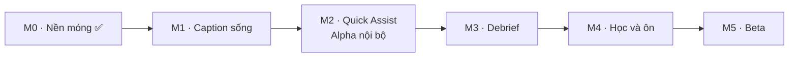

# Backlog và mốc giao hàng

Trang này biến [bản đồ tính năng](./01-features.md), [phạm vi MVP](./03-mvp-scope.md) và [lộ trình](./04-roadmap.md) thành **mốc dùng được** (M1…M5) và **task có chủ** để chia cho Claude và Codex. Nguyên tắc: mỗi mốc kết thúc bằng một thứ người dùng **chạy và thấy được**, không phải một lớp hạ tầng.

## Cách đọc

| Cột       | Ý nghĩa                                                                                                                                                    |
| --------- | ---------------------------------------------------------------------------------------------------------------------------------------------------------- |
| Chủ       | **C** = Claude (lead: native, realtime, AI, tích hợp, review) · **X** = Codex (làm theo brief trong worktree riêng) · **U** = người dùng phải làm/cung cấp |
| Cỡ        | S ≤ nửa ngày · M ≈ 1 ngày · L 2–3 ngày                                                                                                                     |
| Phụ thuộc | Task phải xong trước                                                                                                                                       |
| Brief     | Mỗi task **X** thành một brief `04-brief-*.md` (≤ 1 ngày, ≤ ~10 file) trước khi giao; Claude viết brief và review chéo                                     |

**Quy tắc chia việc.** Giao cho Codex: UI React/web, module CRUD sao chép từ module mẫu `glossary`, schema + client SDK, test, docs module. Giữ cho Claude: Swift/audio, pipeline realtime, prompt + gateway AI, migration nhạy cảm, tích hợp cuối. Mọi thứ Codex làm đều cần Claude cài sẵn dependency (Codex không có mạng) và review chéo.

## Các mốc

| Mốc                 | Người dùng làm được gì                                                                        | Ước lượng | Cổng                                                                                |
| ------------------- | --------------------------------------------------------------------------------------------- | --------- | ----------------------------------------------------------------------------------- |
| **M0** Nền móng     | (đã xong) API, auth, worker, web glossary, khung desktop                                      | —         | ✅                                                                                  |
| **M1** Caption sống | Mở app, bấm ⌘⇧L, thấy **caption tiếng Anh + bản dịch tiếng Việt** của cuộc họp đang diễn ra   | 3 tuần    | Chạy thật với Zoom/Meet: p95 câu gốc ≤ 1 s, dịch ≤ 2,5 s trong 30 phút, không crash |
| **M2** Quick Assist | Tra từ, hỏi "họ vừa nói gì?", gõ tiếng Việt → câu tiếng Anh. **Alpha nội bộ**                 | +2 tuần   | Bạn dùng thật trong 3 cuộc họp thật, ghi lại lỗi                                    |
| **M3** Debrief      | Sau họp mở web xem 5 khối debrief, nghe lại đoạn khó, lưu cụm từ                              | +2 tuần   | Debrief ≤ 2 phút sau họp, đủ 5 khối                                                 |
| **M4** Học và ôn    | Ôn cụm từ từ chính cuộc họp bằng FSRS; xem tiến bộ theo tuần                                  | +2 tuần   | Phiên ôn 5–10 phút, FSRS đúng lịch                                                  |
| **M5** Beta         | Onboarding, đăng nhập trong app, quyền riêng tư (xoá dữ liệu), cài đặt lưu bền, bản `.app` ký | +2 tuần   | 30–50 người dùng thử; H1–H3 đo được                                                 |

Ước lượng giả định Claude + Codex làm song song. **Thứ tự được chọn để sớm có sản phẩm dùng được**: M1 dùng STT on-device và dịch bằng LLM, bỏ qua mọi thứ chưa cần (đăng nhập trong app, lưu phiên) — M1 chạy được ngay với một API key LLM trong `.env`.

## M1 · Caption sống

Đường găng: thu âm hệ thống (Swift) → STT → dịch → overlay. Mọi thứ khác chờ xung quanh nó.

| ID    | Task                                                                                                                                              | Chủ | Phụ thuộc           | Cỡ  | Ghi chú                                                                                 |
| ----- | ------------------------------------------------------------------------------------------------------------------------------------------------- | --- | ------------------- | --- | --------------------------------------------------------------------------------------- |
| M1-01 | **Spike thu âm**: Swift package bắt âm thanh hệ thống (Core Audio Process Tap) + mic, ghi ra file WAV, đo độ trễ; xin quyền TCC                   | C   | —                   | M   | Rủi ro cao nhất; làm đầu tiên. Cần bạn bấm cấp quyền Micro/Audio Capture ở lần chạy đầu |
| M1-02 | **Cầu Swift ↔ Rust**: Swift CLI sidecar xuất PCM/JSON qua stdout; Rust spawn, đọc, phát event Tauri                                               | C   | M1-01               | M   | Quyết định sidecar vs FFI ghi vào ADR nếu khác scaffold                                 |
| M1-03 | **STT on-device**: FluidAudio + Parakeet-TDT, VAD, `transcript.partial/final` có timestamp từ                                                     | C   | M1-02               | L   | Tải model ~600 MB; chạy ngoài sandbox                                                   |
| M1-04 | **Hợp đồng realtime** `@cuelingo/shared` `ws.ts` (hello, segment.final, translation, error) + schema Zod + test                                   | X   | —                   | S   | Theo `04-realtime-pipeline.md`; chạy song song với M1-01                                |
| M1-05 | **ai-gateway**: task `translate` (Vercel AI SDK), timeout 3 s + dự phòng, prompt có phiên bản trong `@cuelingo/prompts`, eval nhỏ trong `ml/eval` | C   | —                   | M   | Cần **U**: một API key LLM (Anthropic/Google/OpenAI) trong `.env`                       |
| M1-06 | **api/realtime**: WebSocket Fastify, xác thực, nhận `segment.final`, dịch với 3 câu trước + glossary, trả `translation`                           | C   | M1-04, M1-05        | L   | Auth WS dùng session Better Auth; M1 cho phép token dev                                 |
| M1-07 | **core-sdk realtime client**: kết nối WS, đệm 60 s khi mất mạng, kết nối lại, kiểu theo `ws.ts`                                                   | X   | M1-04               | M   | Test với WS giả                                                                         |
| M1-08 | **session-controller (desktop)**: nối native event → WS → overlay; trạng thái phiên (idle/running/error); `useSession()`                          | X   | M1-02, M1-07        | M   | Chỉ gọi `native.*` và core-sdk                                                          |
| M1-09 | **Overlay hoàn thiện**: partial nhạt/final đậm, Assist level 4/3/1 đồng bộ main↔overlay (Rust phát event), cỡ chữ 14–24, sáng/tối, ghim           | X   | M1-08               | M   | Cần thêm event `settings` trong Rust: **C** thêm trước, **X** dùng                      |
| M1-10 | **Đo độ trễ end-to-end** + chạy thật với Zoom/Meet 30 phút; ghi số liệu vào docs                                                                  | C   | M1-03, M1-06, M1-09 | M   | Cổng M1                                                                                 |

## M2 · Quick Assist (Alpha nội bộ)

| ID    | Task                                                                                                             | Chủ | Phụ thuộc    | Cỡ  |
| ----- | ---------------------------------------------------------------------------------------------------------------- | --- | ------------ | --- |
| M2-01 | `api/assist`: `lookup` (tra từ theo ngữ cảnh), `recap` (60 s gần nhất), `compose` (VI → 2 câu EN); prompt + eval | C   | M1-05        | L   |
| M2-02 | Glossary cá nhân vào pipeline: gợi ý thuật ngữ cho STT (boost) và prompt dịch; chọn glossary trước họp           | C   | M1-06        | M   |
| M2-03 | `desktop/quick-assist` UI: popup tra từ (click từ trong overlay), ô "Họ vừa nói gì?", ô soạn câu + teleprompter  | X   | M2-01, M1-09 | L   |
| M2-04 | Phím tắt ⌘⇧W (recap) và ⌘⇧S (nói giúp) nối với UI; hotkey event đã có ở Rust                                     | X   | M2-03        | S   |
| M2-05 | Gắn nhãn người nói "Tôi" / "Speaker N" (tách luồng mic/system; diarization nhẹ cho system); đổi tên được         | C   | M1-03        | L   |
| M2-06 | Event học tập: `lookup`, `translation_expanded`, `recap_used`… vào `api/events` (append-only) + schema contract  | X   | M1-04        | M   |
| M2-07 | **Alpha nội bộ**: bạn dùng thật 3 cuộc họp; Claude gom lỗi, sửa, ghi vào review                                  | U+C | tất cả M2    | —   |

## M3 · Debrief

| ID    | Task                                                                                                              | Chủ | Phụ thuộc                  | Cỡ  |
| ----- | ----------------------------------------------------------------------------------------------------------------- | --- | -------------------------- | --- |
| M3-01 | Lưu phiên: `api/sessions` (tạo/kết thúc), lưu segments + events vào Postgres (bảng đã có), tắt lưu audio mặc định | C   | M1-06, M2-06               | M   |
| M3-02 | Đồng bộ desktop → API: client đăng nhập trong app (magic link → deep link `cuelingo://`), token trong Keychain    | C   | M3-01                      | L   |
| M3-03 | `workers/debrief-job`: tóm tắt, quyết định/việc cần làm, cụm từ khó, "câu bạn nói → câu nên nói"; prompt + eval   | C   | M3-01                      | L   |
| M3-04 | `web/debrief`: danh sách phiên + trang chi tiết 5 khối, transcript song ngữ, xuất Markdown                        | X   | M3-03 (hợp đồng DTO trước) | L   |
| M3-05 | Nghe lại đoạn khó 0,75x/1x, ẩn/hiện chữ (cần lưu audio đoạn ngắn có đồng ý)                                       | X   | M3-04                      | M   |
| M3-06 | Nút "Lưu cụm từ" từ debrief → Phrase Bank (API + UI)                                                              | X   | M3-04                      | S   |

## M4 · Học và ôn

| ID    | Task                                                                                                             | Chủ | Phụ thuộc   | Cỡ  |
| ----- | ---------------------------------------------------------------------------------------------------------------- | --- | ----------- | --- |
| M4-01 | `packages/learner-model`: lexicon tiếp nhận/sản xuất, cập nhật từ event, FSRS (thư viện có sẵn), test thuộc tính | C   | M2-06       | L   |
| M4-02 | `api/phrases-review`: Phrase Bank CRUD (copy `glossary`), hàng đợi ôn hôm nay, ghi `review_logs`                 | X   | M4-01 (DTO) | L   |
| M4-03 | `web/review`: phiên ôn 5–10 phút, 3 dạng bài (nhận diện, điền từ, nghe–gõ), có câu gốc + audio                   | X   | M4-02       | L   |
| M4-04 | `api/progress` + `web/progress`: % hiểu, số cụm, streak, chỉ số phụ thuộc theo tuần                              | X   | M4-01       | M   |
| M4-05 | Assist Dial gợi ý nâng/giảm mức từ dữ liệu thật (3 mức MVP)                                                      | C   | M4-01       | M   |
| M4-06 | Bài nghe đánh giá ban đầu (F1/US-02): 5 phút, ra mức nghe + Assist mặc định                                      | X   | M4-01       | M   |

## M5 · Beta

| ID    | Task                                                                                                             | Chủ | Phụ thuộc | Cỡ  |
| ----- | ---------------------------------------------------------------------------------------------------------------- | --- | --------- | --- |
| M5-01 | Onboarding thật: kiểm quyền TCC (micro, ghi màn hình) từ Rust/Swift thay cho `unknown`, hướng dẫn khi bị từ chối | C   | M1-01     | M   |
| M5-02 | Quyền riêng tư: xoá phiên + dữ liệu rút ra, xoá tài khoản, tắt lưu audio, `workers/retention` có storage thật    | C   | M3-01     | M   |
| M5-03 | `desktop/settings` lưu bền (store Tauri) + trang cài đặt web                                                     | X   | M1-09     | M   |
| M5-04 | Nhà cung cấp email production cho magic link, cookie domain cho web ↔ API, Google OAuth                          | C+U | —         | M   |
| M5-05 | Ký + notarize `.app`, tự cập nhật (Tauri updater), kênh phân phối beta                                           | C+U | —         | L   |
| M5-06 | Quan sát: log có cấu trúc, đo chi phí AI / giờ họp (H5), Sentry; tối ưu độ trễ và CPU/RAM phiên 2 giờ            | C   | M1-10     | L   |
| M5-07 | Closed beta: 30–50 người, form phản hồi, dashboard H1–H4                                                         | U+C | tất cả    | —   |

## Giai đoạn 2 · Từ demo đến Beta (kế hoạch song song)

**Hiện trạng (2026-11-01):** M1–M4 đã chạy được từ đầu đến cuối trên máy dev: caption song ngữ, tra từ/tóm tắt/nói giúp, lưu cuộc họp, debrief 5 khối, Phrase Bank, ôn FSRS, tiến độ; desktop có khung giao diện cho cả lộ trình (mục chưa làm ghi "Sắp ra mắt"); web dùng chung khung với desktop. **Chưa làm:** đăng nhập trong app, kiểm quyền macOS thật, nối thuật ngữ vào nhận dạng, đóng gói + ký app, nghe lại đoạn khó, bài nghe, quyền riêng tư, onboarding, quan sát, và các trang học trong app desktop.

**Cách chia làn:** **C** (Claude) giữ phần native (Swift/Rust), AI/prompt, bảo mật/auth, hạ tầng phát hành. **X** (Codex) làm React/Next, CRUD API, test, tài liệu. Mỗi đợt có hai làn chạy cùng lúc; X tối đa 3–4 brief khác thư mục; file dùng chung (`roadmap.ts`, `app.ts`, `server.ts`, `package.json`, lockfile) do C sửa khi gộp. Mỗi task X có brief `04-brief-<id>.md` trong `06-delivery/2026-11-06-phase2/`.

Quy ước trạng thái trong `packages/ui/src/lib/roadmap.ts`: khi một tính năng chạy thật trong một client thì đổi `status.<client>` thành `ready`; mọi mục còn lại tự hiện "Sắp ra mắt".

### Đợt 1 · Nền để người khác dùng được (làm ngay)

| ID       | Task                                                                                                                                                                                                                                                                                                             | Chủ | Phụ thuộc | Cỡ  |
| -------- | ---------------------------------------------------------------------------------------------------------------------------------------------------------------------------------------------------------------------------------------------------------------------------------------------------------------- | --- | --------- | --- |
| P2-01    | **Đăng nhập trong app.** Desktop mở `WEB/login?app=1`; sau magic link web gọi `POST /v1/device/code` (cần session) lấy mã dùng một lần, mở `cuelingo://auth?code=…`; app đổi mã lấy token qua `POST /v1/device/exchange`, lưu token trong Keychain (crate `keyring`), gửi `Authorization: Bearer`. Thu hồi được. | C   | M3-01     | L   |
| P2-02 ✅ | **Quyền macOS thật.** Sidecar Swift có lệnh `--permissions` (micro: `AVCaptureDevice`; thu âm hệ thống: thử mở tap ngắn), Rust lệnh `permissions_status` gọi nó; `PermissionsStep` hiện đúng đã cấp/từ chối/chưa hỏi, nút mở thẳng Cài đặt hệ thống.                                                             | C   | —         | M   |
| P2-03 ✅ | **Đóng gói sidecar vào `.app`** (`bundle.resources`/`externalBin`), build script `pnpm desktop:build`, bỏ biến `CUELINGO_AUDIO_BIN` khi chạy bản đóng gói; ký ad-hoc cho dev, chuẩn bị chỗ gắn chứng chỉ thật.                                                                                                   | C   | —         | M   |
| P2-10 ✅ | **Desktop: Ôn tập + Cụm từ** thành trang thật (dùng `/v1/review/*`, `/v1/phrases`), cùng trải nghiệm với web (phím 1–4, thẻ nhận diện/điền chỗ trống), qua `app/views.ts`.                                                                                                                                       | X   | M4        | L   |
| P2-11 ✅ | **Desktop: Thuật ngữ + Tiến độ** thành trang thật (`/v1/glossary`, `/v1/progress`), thêm/xoá thuật ngữ, biểu đồ 7 ngày và 4 tuần.                                                                                                                                                                                | X   | M4        | M   |
| P2-12 ✅ | **Quyền riêng tư:** `DELETE /v1/sessions/:id`, `DELETE /v1/me/data` (xoá cuộc họp, cụm từ, event, debrief của chính mình, giữ tài khoản), `GET /v1/me/export` (JSON); UI ở trang Cài đặt web và desktop (xác nhận hai bước); `workers/retention` xoá hẳn phiên đã đánh dấu `deleted` sau 7 ngày.                 | X   | M3-01     | M   |
| P2-13 ✅ | **Web: trang chủ giới thiệu + trang tải app** (`/` cho khách chưa đăng nhập: giá trị chính, ba bước dùng, ảnh minh hoạ overlay vẽ bằng HTML, nút tải/đăng ký chờ; `/download` hướng dẫn cài và cấp quyền). Dùng skill thiết kế đã cài, không dùng gradient/thẻ icon.                                             | X   | —         | M   |

### Đợt 2 · Dùng hằng ngày được

| ID       | Task                                                                                                                                                                                                                | Chủ | Phụ thuộc    | Cỡ  |
| -------- | ------------------------------------------------------------------------------------------------------------------------------------------------------------------------------------------------------------------- | --- | ------------ | --- |
| P2-04    | **Nối thuật ngữ vào nhận dạng.** Khi bắt đầu phiên desktop lấy glossary của người dùng, gửi `vocab [...]` tới sidecar (lệnh Rust mới), làm mới khi đổi; thêm cụm nhiều từ vào bộ sửa; prompt dịch đã nhận glossary. | C   | P2-01        | M   |
| P2-05 ✅ | **Giọng đọc (TTS):** task `tts.speak` trong `ai-gateway`, job `tts-cache` lưu file theo hash văn bản, endpoint `GET /v1/tts?text=` trả URL ký; lưu cục bộ khi dev, S3-tương-thích khi có.                           | C   | —            | L   |
| P2-14    | **Onboarding đầu tiên (desktop):** 4 bước (chào, cấp quyền với trạng thái thật, thử caption mẫu, chọn mức hỗ trợ), chỉ hiện lần đầu, lưu bền.                                                                       | X   | P2-02        | M   |
| P2-15    | **Cài đặt lưu bền:** `GET/PATCH /v1/me/settings` (mức hỗ trợ mặc định, ngôn ngữ giao diện, giữ audio hay không), desktop lưu cục bộ bằng store Tauri và đồng bộ, trang Cài đặt web.                                 | X   | P2-01        | M   |
| P2-16    | **Debrief hoàn thiện:** bấm đoạn khó mở transcript tại đúng câu, lọc theo người nói, sao chép/đính kèm debrief, tải Markdown cả cuộc họp, trạng thái "đang tạo" có tiến trình.                                      | X   | M3           | M   |
| P2-17 ✅ | **Bài nghe–gõ + nghe phát âm cụm từ** trong ôn tập (web và desktop) dùng `GET /v1/tts`.                                                                                                                             | X   | P2-05, P2-10 | M   |
| P2-06    | **Nghe lại đoạn khó:** sidecar cắt clip ngắn quanh câu khi người dùng bật và đồng ý, tải lên kho file, debrief phát 0,75×/1×, tự xoá theo hạn lưu.                                                                  | C   | P2-12, U     | L   |

### Đợt 3 · Học thông minh và phát hành

| ID       | Task                                                                                                                                                                         | Chủ | Phụ thuộc | Cỡ  |
| -------- | ---------------------------------------------------------------------------------------------------------------------------------------------------------------------------- | --- | --------- | --- |
| P2-07 ✅ | **Assist Dial tự gợi ý:** luật thuần trong `learner-model` (đề xuất giảm mức khi % hiểu ≥ 85 ba cuộc họp liền, tăng khi < 60; không tự đổi), `GET /v1/me/assist-suggestion`. | C   | M4        | M   |
| P2-18 ✅ | **UI gợi ý Assist Dial:** thẻ trên Phiên họp (desktop) và Tiến độ (web) với "Áp dụng / Để sau", ghi event.                                                                   | X   | P2-07     | S   |
| P2-08    | **Bài nghe đánh giá đầu vào:** 6 đoạn nghe có TTS, chấm điểm, ra mức nghe + Assist mặc định (`POST /v1/placement`).                                                          | C   | P2-05     | M   |
| P2-19    | **UI bài đánh giá** (web + desktop), có thể làm lại.                                                                                                                         | X   | P2-08     | M   |
| P2-20    | **Quan sát:** log có cấu trúc + request id, đo chi phí AI mỗi giờ họp (bảng `events`), trang nội bộ `/admin/metrics` số liệu H1–H5, Sentry tuỳ chọn qua biến môi trường.     | X   | —         | M   |
| P2-21    | **Kiểm thử đầu-cuối:** Playwright cho web (đăng nhập magic link dev → cuộc họp → debrief → lưu cụm từ → ôn → tiến độ), chạy trong CI.                                        | X   | P2-13     | M   |
| P2-09    | **Ký + notarize + tự cập nhật + kênh phát hành:** workflow GitHub Actions dựng `.dmg`, ký, notarize, Tauri updater, trang `/download` trỏ bản mới nhất.                      | C+U | P2-03, U  | L   |

### Đợt 4 · Closed beta

| ID    | Task                                                                                                                            | Chủ | Phụ thuộc | Cỡ  |
| ----- | ------------------------------------------------------------------------------------------------------------------------------- | --- | --------- | --- |
| P2-22 | **M1-10 chạy thật:** Zoom/Meet 30 phút, đo p95 độ trễ, overlay không lộ khi chia sẻ màn hình, CPU/RAM phiên 2 giờ; ghi số liệu. | U+C | P2-03     | M   |
| P2-23 | **Đăng nhập thật:** Google OAuth, email gửi magic link (nhà cung cấp), cookie domain web ↔ API, CORS theo domain thật.          | C+U | —         | M   |
| P2-24 | **Nhãn người nói "Speaker N"** (tách người trong luồng hệ thống) và đổi tên người nói trong debrief.                            | C   | P2-16     | L   |
| P2-25 | **Form phản hồi + dashboard H1–H4**, mời 30–50 người dùng thử, vòng sửa lỗi hai tuần.                                           | U+C | tất cả    | —   |

### Thứ tự chạy và ranh giới file

- **Đợt 1** chạy ngay: C làm P2-02 rồi P2-01 rồi P2-03; X làm P2-10, P2-11, P2-12, P2-13 song song (khác thư mục: `apps/desktop/src/study/*`, `apps/desktop/src/study/*` thuật ngữ + tiến độ ở thư mục riêng, `services/api/modules/privacy`, `apps/web/src/app/(public)`).
- Mọi trang mới của desktop đăng ký qua `apps/desktop/src/app/views.ts`; mỗi brief thêm đúng một dòng. C đổi `roadmap.ts` sau khi gộp.
- **Cổng giữa các đợt:** `pnpm verify` xanh, người dùng thử bản `.app` mới, cập nhật mục này (đánh ✅), rồi mới mở đợt kế.
- **Việc của người dùng (U)** theo đợt: Đợt 1: không. Đợt 2: nơi lưu file (S3-tương-thích hoặc dùng đĩa cục bộ khi demo). Đợt 3: tài khoản Apple Developer. Đợt 4: tài khoản email gửi thư, khoá Google OAuth, domain, họp thử thật.
- **Rủi ro mới:** token thiết bị (P2-01) là thay đổi bảo mật, cần review kỹ; nơi lưu audio (P2-06) liên quan quyền riêng tư nên mặc định tắt và cần đồng ý rõ; chi phí TTS (P2-05) cần cache theo hash để không gọi lặp.

## Giai đoạn 3 · Đa ngôn ngữ (theo [ADR 0013](../08-adr/0013-multi-language.md))

Ví dụ dẫn đường: họp tiếng Anh lúc 9 giờ, tiếng Nhật lúc 10 giờ. Ngôn ngữ thuộc **từng cuộc họp**; dữ liệu học (từ vựng, lịch ôn, tiến độ, mức nghe) tách **theo từng ngôn ngữ**; chuỗi ngày và tài khoản dùng chung.

| ID       | Task                                                                                                                                                                                                                                                                 | Chủ | Phụ thuộc | Cỡ  |
| -------- | -------------------------------------------------------------------------------------------------------------------------------------------------------------------------------------------------------------------------------------------------------------------- | --- | --------- | --- |
| P3-01 ✅ | **Nền dữ liệu:** migration thêm `language` cho `sessions`, `lexical_items`, `glossary_terms`, bảng `learner_languages`, đổi khoá duy nhất, điền `en`; `SUPPORTED_LANGUAGES` ở `@cuelingo/shared`. Không đổi hành vi.                                                 | C   | —         | M   |
| P3-02    | **API theo ngôn ngữ:** tạo cuộc họp có `language`; danh sách, hàng đợi ôn, cụm từ, thuật ngữ, tiến độ nhận `language`; ghi lấy ngôn ngữ từ tài nguyên; test chống lẫn dữ liệu giữa hai ngôn ngữ.                                                                     | C   | P3-01     | L   |
| P3-03 ✅ | **Chọn ngôn ngữ họp trong app:** bộ chọn ở thẻ Caption trực tiếp và overlay (nhớ lần gần nhất, danh sách đã dùng), gửi `language` khi tạo cuộc họp và trong `hello`; bộ chuyển ngôn ngữ ở Ôn tập, Cụm từ, Thuật ngữ, Tiến độ (web và desktop, dùng component chung). | X   | P3-02     | L   |
| P3-04 ✅ | **Sidecar nhiều model:** lệnh `language <mã>`, chọn model nhận dạng theo ngôn ngữ, tải và nạp model có thanh tiến độ, đổi giữa chừng; đo p95.                                                                                                                        | C   | P3-01     | L   |
| P3-05 ✅ | **Tiếng Nhật làm ngôn ngữ thứ hai:** `translate.realtime@v2` theo cặp ngôn ngữ, prompt tra từ/tóm tắt/soạn câu/debrief có ngôn ngữ và chữ đọc, giọng đọc theo ngôn ngữ, eval dịch và nhận dạng với bộ mẫu tiếng Nhật.                                                | C   | P3-04     | L   |
| P3-06    | **Tách từ và bài gõ theo ngôn ngữ:** `Intl.Segmenter` cho bấm tra từ; so khớp ký tự cho tiếng Nhật trong bài nghe–gõ; hiển thị chữ đọc.                                                                                                                              | X   | P3-05     | M   |
| P3-07    | **Mức nghe và Assist Dial theo ngôn ngữ:** dùng `learner_languages`; gợi ý đổi mức tính riêng từng ngôn ngữ; bài đánh giá đầu vào làm riêng cho mỗi ngôn ngữ.                                                                                                        | C+X | P3-02     | M   |
| P3-08    | **Tự nhận ngôn ngữ và gợi ý từ lịch:** nhận dạng ngôn ngữ ở vài giây đầu, đề xuất đổi ("nghe như tiếng Nhật, đổi?"); đọc lịch để gợi ý ngôn ngữ trước giờ họp.                                                                                                       | C   | P3-05     | M   |

Thứ tự: P3-01 → P3-02 làm trước vì không đổi hành vi nên an toàn; P3-03 và P3-04 chạy song song; P3-05 là cổng kiểm chứng kiến trúc (chất lượng tiếng Nhật), chỉ khi qua eval mới bật cho người dùng.

## Việc cần từ người dùng (U)

| Khi nào      | Việc                                                                                               |
| ------------ | -------------------------------------------------------------------------------------------------- |
| Trước M1-05  | Một API key LLM (nhà cung cấp tuỳ bạn) đặt vào `.env`. Khuyến nghị bắt đầu với một model rẻ, nhanh |
| M1-01        | Bấm cấp quyền Micro và Audio Capture/Screen Recording cho app khi macOS hỏi                        |
| M2-07, M5-07 | Dùng thật và báo lỗi                                                                               |
| M5-04, M5-05 | Tài khoản email gửi thư, tài khoản Apple Developer (ký app), domain                                |

## Điều chưa chắc và cách giảm rủi ro

| Rủi ro                                                              | Giảm thiểu                                                                                         |
| ------------------------------------------------------------------- | -------------------------------------------------------------------------------------------------- |
| Bắt âm thanh hệ thống trên macOS (quyền, phiên bản) khó hơn dự kiến | M1-01 là spike đứng riêng, làm đầu tiên; nếu Process Tap lỗi thì dùng ScreenCaptureKit (macOS 13+) |
| STT on-device chưa đo streaming thật                                | M1-03 đo ngay; nếu vượt ngân sách thì bật chế độ STT cloud (đã có trong thiết kế, ADR-0003)        |
| Độ trễ dịch vượt 2,5 s                                              | Dịch theo cụm trước khi hết câu, model nhỏ hơn, dự phòng; đo ở M1-10                               |
| Codex không có mạng, không chạy cargo/Swift                         | Claude cài sẵn dependency; giao cho Codex chỉ phần TS/React; native luôn là của Claude             |
| Lockfile và `shared/index.ts` xung đột khi nhiều brief song song    | Tối đa hai brief của Codex cùng lúc, khác thư mục; Claude merge và tạo lại lockfile                |

## Cách chạy từng task

Task của **C**: `task-loop` (spec → plan → kết quả), commit theo bước. Task của **X**: Claude viết `04-brief-<id>.md` trong hồ sơ của mốc, tạo worktree `.worktrees/<slug>-codex`, cài sẵn dependency, chạy Codex, review chéo, merge. Hồ sơ mỗi mốc nằm trong [Delivery Log](../06-delivery/README.md).
