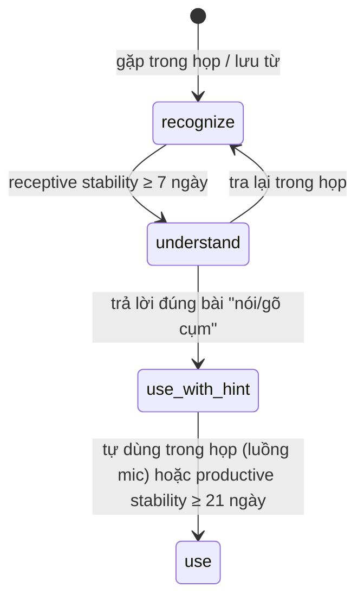

# Learner Model

Learner Model là "bản sao ngôn ngữ" của mỗi người dùng: họ hiểu gì, nói được gì, yếu ở đâu, sắp phải giao tiếp với ai. Event log là nguồn sự thật. Trạng thái hiện tại (lexicon, kỹ năng, chỉ số) đều được tính ra từ event và có thể tính lại khi đổi thuật toán.

## Các lớp

| Lớp                              | Nội dung                                                                 | MVP                          |
| -------------------------------- | ------------------------------------------------------------------------ | ---------------------------- |
| Profile                          | Ngôn ngữ mẹ đẻ/đích, nghề, mục tiêu, lịch                                | Có                           |
| Skill state                      | Ước lượng CEFR + độ tin cậy cho nghe, nói, đọc, viết, phát âm            | Chỉ nghe (`listening_level`) |
| Lexicon                          | Từ/cụm, mỗi mục có trạng thái FSRS **receptive** và **productive** riêng | Có                           |
| Listening profile                | WPM chịu được, accent khó, lỗi nối âm                                    | Giai đoạn 2                  |
| Speaking / pronunciation profile | Fluency, lỗi âm vị                                                       | Giai đoạn 2                  |
| Error patterns                   | Lỗi ngữ pháp, từ vựng lặp lại                                            | Giai đoạn 2                  |
| Social graph                     | Người hay giao tiếp: accent, vai trò, chủ đề                             | Speakers cơ bản              |
| Context memory                   | Dự án, cuộc họp sắp tới                                                  | Giai đoạn 3                  |

## Lexicon và giai đoạn

Ngưỡng là đề xuất ban đầu, sẽ chỉnh sau beta. Logic nằm ở [`@cuelingo/learner-model`](../04-modules/05-packages/learner-model.md).

## Event → cập nhật

| Event                                           | Ảnh hưởng                                                          |
| ----------------------------------------------- | ------------------------------------------------------------------ |
| `lookup` (tra từ trong họp)                     | Ghi một lần "Again" vào receptive của từ đó; tăng `lookup_count`   |
| `translation_expanded` (mở bản dịch ở Assist 3) | Đánh dấu segment là "không tự hiểu"; ảnh hưởng `comprehension_pct` |
| `ask_recap`                                     | Đánh dấu các segment trong cửa sổ recap là "không tự hiểu"         |
| `phrase_saved`                                  | Tạo mục lexicon, `in_review = true`                                |
| `review_answer`                                 | Cập nhật FSRS theo dạng bài: nghe → receptive, nói/gõ → productive |
| `segment_final` (luồng mic) chứa cụm đang học   | Tín hiệu productive tự nhiên                                       |

## Comprehension %

`comprehension_pct` = số segment của luồng `system` không bị đánh dấu "không tự hiểu" / tổng số segment luồng `system`. Chỉ tính ở Assist ≤ 3, vì ở Assist 4 bản dịch luôn hiện.

## Assist Dial

| Mức | Nghe                       | Nói                            |
| --- | -------------------------- | ------------------------------ |
| 5   | Caption song ngữ           | AI nói thay                    |
| 4   | Caption song ngữ           | Gợi ý câu đầy đủ, teleprompter |
| 3   | Tiếng Anh, chỉ dịch từ khó | Gợi ý từ khoá                  |
| 2   | Chỉ hiện từ khó            | Gợi ý khi im lặng > 3 giây     |
| 1   | Chỉ ghi chép               | Review sau họp                 |
| 0   | Tắt                        | Tắt                            |

MVP có các mức 4, 3, 1. Luật đề xuất hạ mức (MVP): % hiểu ≥ 70% trong 3 cuộc họp liên tiếp ở mức hiện tại thì gợi ý thử mức thấp hơn. AI chỉ đề xuất, không tự hạ giữa cuộc họp.

## Giai đoạn sau

- BKT (pyBKT) cho kỹ năng nghe và phát âm theo âm vị.
- Temporal knowledge graph (Graphiti) cho context memory và social graph.
