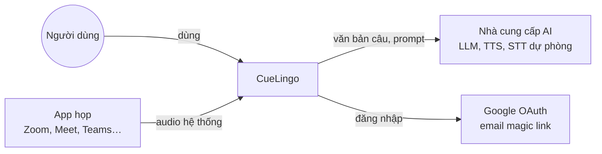
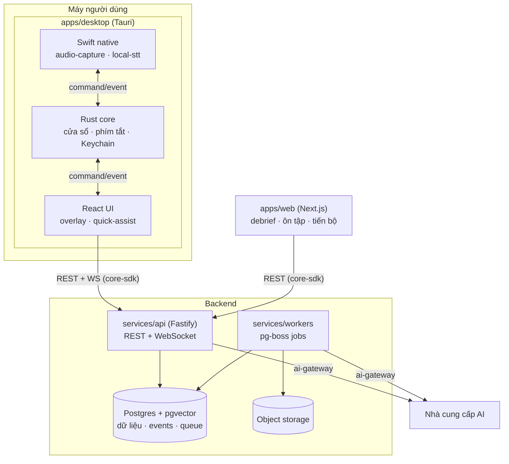
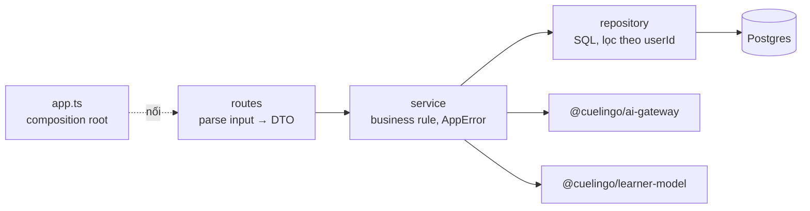
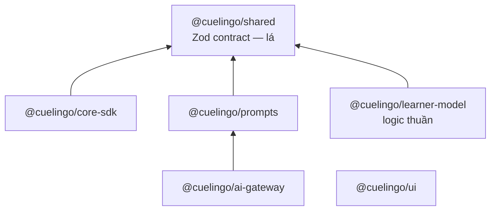

# Kiến trúc phần mềm

CueLingo là một **modular monolith** gồm bốn tiến trình chạy thật: app desktop, web app, API và workers. Chúng dùng chung một Postgres và một tầng package TypeScript. Kiến trúc được giữ bằng **luật phụ thuộc kiểm bằng máy**, không chỉ bằng quy ước. Trang này đi từ ngoài vào trong: bối cảnh → các tiến trình → các lớp bên trong mỗi tiến trình → các vấn đề xuyên suốt.

## 1. Bối cảnh (CueLingo nói chuyện với ai)

| Bên ngoài              | CueLingo gửi / nhận                                                         | Ràng buộc                                                         |
| ---------------------- | --------------------------------------------------------------------------- | ----------------------------------------------------------------- |
| App họp                | Chỉ **đọc audio hệ thống** trên máy; không tích hợp API của Zoom/Meet ở MVP | Không cần host bật tính năng                                      |
| Nhà cung cấp AI        | Văn bản câu, ngữ cảnh ngắn, glossary. **Không gửi audio** khi STT on-device | Chỉ nhà cung cấp được duyệt ([Bảo mật](./08-security-privacy.md)) |
| Nhà cung cấp danh tính | OAuth / magic link                                                          | Qua Better Auth (đề xuất)                                         |

## 2. Các tiến trình (containers)

| Tiến trình | Trách nhiệm                                                                   | Giao tiếp                                                           | Trạng thái             |
| ---------- | ----------------------------------------------------------------------------- | ------------------------------------------------------------------- | ---------------------- |
| Desktop    | Thu âm, STT trên máy, overlay, Quick Assist                                   | REST + WebSocket tới API qua `core-sdk`; Tauri command/event nội bộ | Khung                  |
| Web        | Thư viện họp, debrief, ôn tập, tiến bộ, quản lý dữ liệu                       | REST tới API qua `core-sdk`                                         | Feature mẫu `glossary` |
| API        | Auth, phiên họp, dịch realtime, assist, Learner Model, ôn tập, quyền riêng tư | Postgres; enqueue job pg-boss; AI qua gateway                       | Module mẫu `glossary`  |
| Workers    | Debrief, tính lại Learner Model, TTS, dọn dữ liệu                             | Postgres (pg-boss); AI qua gateway; object storage                  | Khung                  |

API và workers **không gọi nhau trực tiếp**: API enqueue job vào Postgres, worker xử lý rồi ghi kết quả vào Postgres.

## 3. Các lớp bên trong

### API và workers

- `app.ts` là nơi duy nhất nối repository → service → routes. Test thay repository bằng bản in-memory.
- Module chỉ gọi module khác qua `index.ts`. Worker job gọi cùng các service/package, không import code của API.

### Desktop

| Lớp            | Code                                                  | Không được                  |
| -------------- | ----------------------------------------------------- | --------------------------- |
| Native (Swift) | `native/macos-audio`                                  | Chứa logic sản phẩm, gọi AI |
| Core (Rust)    | `src-tauri/src`                                       | Chứa logic sản phẩm         |
| UI (React)     | `src/<module>` → store phiên (`session`) → `core-sdk` | Gọi `fetch` trực tiếp       |

Ranh giới Swift ↔ Rust ↔ UI là **bảng command/event có tên** trong [tauri-core](../04-modules/01-desktop/tauri-core.md).

### Web

`src/app/*` (route, chỉ render) → `src/features/<x>` (component trình bày + hook `use-<x>`) → `src/lib/client.ts` (`core-sdk`).

### Package dùng chung

| Luật                                                             | Kiểm bằng          |
| ---------------------------------------------------------------- | ------------------ |
| `apps/*` ↛ `services/*` và ngược lại; `packages/*` ↛ app/service | dependency-cruiser |
| `shared` là lá; `learner-model` không I/O                        | dependency-cruiser |
| Module/feature chỉ gọi nhau qua `index.ts`; không vòng phụ thuộc | dependency-cruiser |
| SDK AI chỉ trong `ai-gateway`                                    | ESLint             |

## 4. Vấn đề xuyên suốt

| Vấn đề        | Cách làm                                                                           | Ở đâu                                                                 |
| ------------- | ---------------------------------------------------------------------------------- | --------------------------------------------------------------------- |
| Contract      | Zod schema là nguồn sự thật; client parse cả response                              | `@cuelingo/shared`, `core-sdk`                                        |
| Lỗi           | `AppError(code)` → `{ error: { code, message, details } }`; client nhận `ApiError` | `services/api/src/lib/errors.ts`                                      |
| Xác thực      | Hook gắn `request.userId`; mọi query lọc theo user                                 | `services/api/src/lib/auth.ts`                                        |
| Cấu hình      | Biến môi trường, đọc một lần ở `server.ts`, mẫu ở `.env.example`                   | mỗi service                                                           |
| Event học tập | Append-only, idempotent theo `id`; nguồn của Learner Model                         | [Mô hình dữ liệu](./07-data-model.md)                                 |
| Chi phí AI    | Gateway ghi `ai_call` mỗi lời gọi                                                  | [Kiến trúc AI](./06-ai-architecture.md)                               |
| Log           | Pino (Fastify) dạng JSON; không log transcript/audio/token                         | [privacy-security](../05-engineering/conventions/privacy-security.md) |

## 5. Thuộc tính chất lượng → chiến thuật

| Thuộc tính      | Mục tiêu                                | Chiến thuật kiến trúc                                                   |
| --------------- | --------------------------------------- | ----------------------------------------------------------------------- |
| Độ trễ          | Câu gốc p95 ≤ 1 s, bản dịch p95 ≤ 2,5 s | STT trên máy; chỉ gửi câu final; một WS/phiên; model nhỏ cho realtime   |
| Quyền riêng tư  | Audio không rời máy theo mặc định       | STT on-device; không lưu audio; lọc theo user ở repository              |
| Chi phí         | Đủ để gói Pro có lãi                    | Không trả tiền STT cloud mặc định; VAD; routing model; cache TTS        |
| Dễ tiến hoá     | Đổi model/thuật toán không sửa sản phẩm | AI gateway + prompt có phiên bản; event log tính lại được Learner Model |
| Agent code đúng | Module mới giống module mẫu             | Extension points, module mẫu, luật phụ thuộc trong CI                   |
