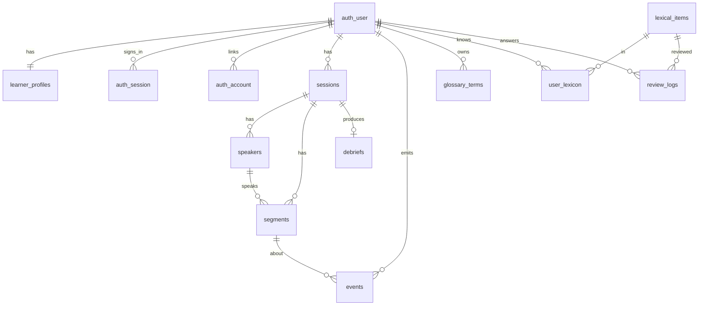

# Mô hình dữ liệu

Postgres 16 + pgvector là DB duy nhất của MVP. Bảng `events` (append-only) là nguồn sự thật cho Learner Model. `user_lexicon`, `comprehension_pct` và chỉ số tiến bộ là dữ liệu tính ra, có thể tính lại. Migration: `infra/db/migrations/` (dbmate, [ADR-0009](../08-adr/0009-migrations-dbmate.md)); bảng định danh do Better Auth sở hữu ([ADR-0008](../08-adr/0008-auth-better-auth.md)).

| Bảng                                                                | Vai trò                                                                                                                                                       | Module ghi                             |
| ------------------------------------------------------------------- | ------------------------------------------------------------------------------------------------------------------------------------------------------------- | -------------------------------------- |
| `auth_user` · `auth_session` · `auth_account` · `auth_verification` | Danh tính và đăng nhập (Better Auth sở hữu; cột camelCase; id uuid do Postgres sinh)                                                                          | api/auth (Better Auth)                 |
| `learner_profiles`                                                  | Profile, mức nghe, Assist mặc định, settings; mỗi người một dòng, tạo ngay sau khi đăng ký                                                                    | api/auth (hook), api/learner           |
| `sessions`                                                          | Một cuộc họp: thời gian, Assist level, nguồn STT, consent, chi phí                                                                                            | api/sessions                           |
| `speakers`                                                          | Người nói trong phiên (`me`, `speaker_1`…`speaker_8`; duy nhất theo `(session_id, label)`; `display_name` ≤ 40 ký tự, do người dùng đặt; không lưu mẫu giọng) | api/realtime                           |
| `segments`                                                          | Câu đã chốt: gốc, bản dịch, timestamp từng từ, embedding                                                                                                      | api/realtime                           |
| `events`                                                            | Mọi tương tác, idempotent theo `id` do client sinh                                                                                                            | api/events                             |
| `glossary_terms`                                                    | Thuật ngữ cá nhân                                                                                                                                             | api/glossary                           |
| `lexical_items`                                                     | Từ/cụm dùng chung                                                                                                                                             | api/phrases-review                     |
| `user_lexicon`                                                      | Trạng thái FSRS receptive/productive, giai đoạn, ngữ cảnh gốc                                                                                                 | api/learner, workers/learner-recompute |
| `debriefs`                                                          | Kết quả debrief, có phiên bản và `prompt_version`                                                                                                             | workers/debrief-job                    |
| `review_logs`                                                       | Kết quả từng lần ôn                                                                                                                                           | api/phrases-review                     |
| `invites` · `invite_redemptions`                                    | Mã mời beta: chỉ lưu SHA-256, số lần dùng, hạn, thu hồi; mỗi người dùng một lần tiêu mã                                                                       | api/invites, api/auth (cổng đăng ký)   |

## Quy tắc

- `user_id` ở mọi bảng nghiệp vụ tham chiếu `auth_user(id)` (uuid). Bảng `sessions` là **cuộc họp**; `auth_session` là phiên đăng nhập, hai thứ khác nhau.
- Không bao giờ sửa bảng `auth_*` bằng tay; nâng phiên bản Better Auth → đối chiếu schema của nó (test integration `auth-schema` bắt lệch) rồi thêm migration mới.

- Xoá `sessions` sẽ cascade sang `segments`, `speakers`, `events`, `debriefs`. `user_lexicon` giữ lại nhưng `first_context_segment_id` về NULL (thẻ còn, câu gốc mất), đúng yêu cầu US-15.
- `speakers`: unique `(session_id, label)` để upsert an toàn khi hai câu tới cùng lúc; CHECK `label ~ '^(me|speaker_[1-8])$'` và `char_length(display_name) <= 40`. `segments.speaker_id` có index; câu cũ để NULL (hiện theo `source`).
- Audio (nếu người dùng cho phép) lưu ở object storage theo `segments.audio_key`, tự xoá sau 30 ngày.
- `events.id` do client sinh (UUID v7) để gửi lại an toàn khi mất mạng.

## Catalog event (MVP)

`session_started` · `session_ended` · `segment_final` · `translation_shown` · `translation_expanded` · `lookup` · `ask_recap` · `compose_assist` · `phrase_saved` · `debrief_opened` · `debrief_feedback` · `review_session` · `review_answer` · `assist_level_changed` · `data_deleted` · `ai_call` (nội bộ)

Schema từng event: `@cuelingo/shared` (`events.ts`).
