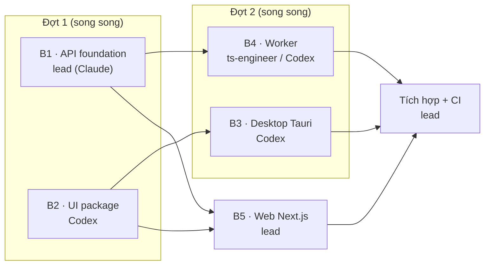

# Plan — foundation

## 1. Bối cảnh code

- Đã chạy: `services/api` (Fastify, module mẫu `glossary`, auth header dev), `packages/{shared,core-sdk}`, `apps/web/src/features/glossary` (component rời, chưa có Next.js), harness + CI `pnpm verify`.
- Công thức từng phần: [Scaffold](../../05-engineering/scaffold/README.md) — trang 02 → 06 là phạm vi giai đoạn này. Trang 07 (Swift) thuộc giai đoạn Đường realtime.
- Môi trường: Rust 1.89, Swift 6.3, Xcode 26.4 sẵn sàng; Docker cài nhưng daemon chưa chạy.

## 2. Phương án tổ chức công việc

| #   | Phương án                                                                                                    | Ưu                                                                 | Nhược                                                                                     |
| --- | ------------------------------------------------------------------------------------------------------------ | ------------------------------------------------------------------ | ----------------------------------------------------------------------------------------- |
| A   | Một agent làm tuần tự 5 phần                                                                                 | Đơn giản, không xung đột                                           | Chậm; không thử được harness nhiều agent                                                  |
| B   | **Chia theo đợt**: lead (Claude) làm phần nhạy cảm, Codex làm phần độc lập trong worktree riêng, review chéo | Nhanh hơn; thử thật brief + scaffold; phần auth/DB vẫn do lead giữ | Phải quản lý phạm vi file, lockfile khi tích hợp                                          |
| C   | Giao song song cả 5 phần cùng lúc                                                                            | Nhanh nhất trên lý thuyết                                          | Web phụ thuộc auth + UI kit; xung đột `package.json`, `pnpm-lock.yaml`, `shared/index.ts` |

**Chọn: B.** Phần chạm DB schema và bảo mật (auth) do lead làm; phần không phụ thuộc giao Codex trước để kiểm chứng harness sớm.

| Tác động                            | Có?   | Chi tiết                                                                                                                                                   |
| ----------------------------------- | ----- | ---------------------------------------------------------------------------------------------------------------------------------------------------------- |
| DB migration                        | Có    | Chuyển `0001` sang dbmate (lần sửa duy nhất, chưa chạy ở đâu); thêm bảng Better Auth; `users` → `learner_profiles`; `user_id` theo kiểu id của Better Auth |
| Contract (`@cuelingo/shared`)       | Có    | `jobs.ts` (tên job + payload)                                                                                                                              |
| Event / Learner Model               | Không |                                                                                                                                                            |
| Prompt / model AI                   | Không |                                                                                                                                                            |
| Quyền riêng tư / dữ liệu người dùng | Có    | Bảng session/account; bỏ header dev khỏi production                                                                                                        |

## 3. Các đợt và bước

| Brief                 | Ai                     | Công thức                                                            | Bước (≈ commit)                                                                                                                                     | AC                 |
| --------------------- | ---------------------- | -------------------------------------------------------------------- | --------------------------------------------------------------------------------------------------------------------------------------------------- | ------------------ |
| **B1** API foundation | Lead                   | [api-foundation](../../05-engineering/scaffold/02-api-foundation.md) | config → dbmate + chuyển `0001` → `shared/jobs` + `lib/queue` → Better Auth (`resolveUserId`, bỏ header dev) → int test Testcontainers → Dockerfile | AC1–AC5, AC9       |
| **B2** UI package     | Codex                  | [ui-package](../../05-engineering/scaffold/05-ui-package.md)         | Tailwind 4 + tokens → shadcn `components.json` → Button, Input, Card, CaptionLine                                                                   | (nền cho AC7, AC8) |
| **B3** Desktop        | Codex                  | [desktop-tauri](../../05-engineering/scaffold/06-desktop-tauri.md)   | Vite + React → `tauri init` → 2 cửa sổ + overlay → command/hotkey → `native.ts`                                                                     | AC8                |
| **B4** Worker         | ts-engineer hoặc Codex | [worker](../../05-engineering/scaffold/03-worker.md)                 | `worker.ts` + config → job `retention.sweep` + test → Dockerfile                                                                                    | AC6, AC9           |
| **B5** Web            | Lead                   | [web-nextjs](../../05-engineering/scaffold/04-web-nextjs.md)         | Next.js App Router → Query provider + auth client → `glossary` sang TanStack Query + `@cuelingo/ui` → login                                         | AC3, AC7           |
| **Tích hợp**          | Lead                   | —                                                                    | Merge nhánh brief, tạo lại lockfile, CI: service Postgres + `db:migrate` + `test:int` + docker build, review chéo, `03-review.md`                   | AC10               |

Brief từng phần nằm cạnh file này (`04-brief-*.md`). Brief đợt 1 viết sẵn; đợt 2 viết khi đợt 1 xong, để phản ánh API/UI thực tế.

## 4. Rủi ro

| Rủi ro                                                      | Giảm thiểu                                                                                         |
| ----------------------------------------------------------- | -------------------------------------------------------------------------------------------------- |
| Tích hợp Better Auth với Fastify/postgres.js khác tài liệu  | Theo hướng dẫn Fastify chính thức; driver `pg` riêng cho auth; `resolveUserId` tách auth khỏi test |
| Kiểu id của Better Auth (chuỗi) lệch với cột `user_id uuid` | Sinh schema bằng `npx auth@latest generate` trước, rồi chỉnh cột `user_id` cho khớp                |
| Tailwind không quét class trong `packages/ui` hoặc app      | `@source` trong `globals.css`; DoD kiểm render ở cả web và desktop                                 |
| Overlay trong suốt / không bị quay màn hình trên macOS      | Thử thật với Zoom/Meet; nếu `contentProtected` không đủ → ghi lại, xử lý ở Rust                    |
| Xung đột `pnpm-lock.yaml` giữa các worktree                 | Brief cấm sửa lockfile ngoài worktree của mình; lead tạo lại khi tích hợp                          |
| Docker chưa chạy → không chạy được migration, int test      | Bật Docker Desktop trước B1 bước 2; phần còn lại làm được không cần DB                             |
| Codex chưa từng chạy với harness này                        | B2 nhỏ, độc lập — nếu kết quả lệch, sửa brief/scaffold trước khi giao B3                           |
