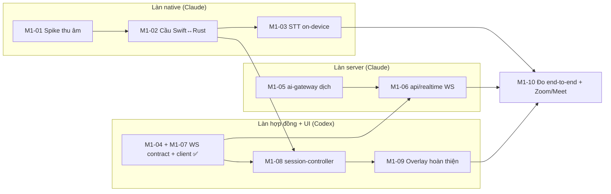

# Plan — M1 Caption sống

Backlog đầy đủ: [06-backlog.md](../../02-product/06-backlog.md). Trang này là kế hoạch thi công M1.

## Làn việc

## Tiến độ

| Task  | Chủ | Trạng thái   | Ghi chú                                                                                          |
| ----- | --- | ------------ | ------------------------------------------------------------------------------------------------ |
| M1-01 | C   | ⏳ chờ quyền | Swift chạy, frame tới sau ~250 ms; tín hiệu = 0 vì chưa cấp quyền Micro / System Audio Recording |
| M1-04 | X   | ✅           | Hợp đồng `ws` trong `@cuelingo/shared`                                                           |
| M1-07 | X   | ✅           | Client realtime trong `@cuelingo/core-sdk` (đệm 60 s, backoff)                                   |
| M1-05 | C   | 🔶 đang đo   | Prompt v1 + gateway + fallback xong, 91 test xanh; đo Gemini thật: xem bảng dưới                 |
| M1-02 | C   | chờ M1-01    |                                                                                                  |
| M1-03 | C   | chờ M1-02    |                                                                                                  |
| M1-06 | C   | tiếp theo    | Có thể làm ngay vì không phụ thuộc native                                                        |
| M1-08 | X   | chờ M1-02    | Brief viết khi M1-02 xong                                                                        |
| M1-09 | X   | chờ M1-08    | Cần Claude thêm event `settings` trong Rust trước                                                |
| M1-10 | C   | cuối         | Cổng M1                                                                                          |

## Rủi ro

Xem [backlog](../../02-product/06-backlog.md#điều-chưa-chắc-và-cách-giảm-rủi-ro). Rủi ro hiện tại cao nhất: quyền macOS và STT streaming chưa đo.
