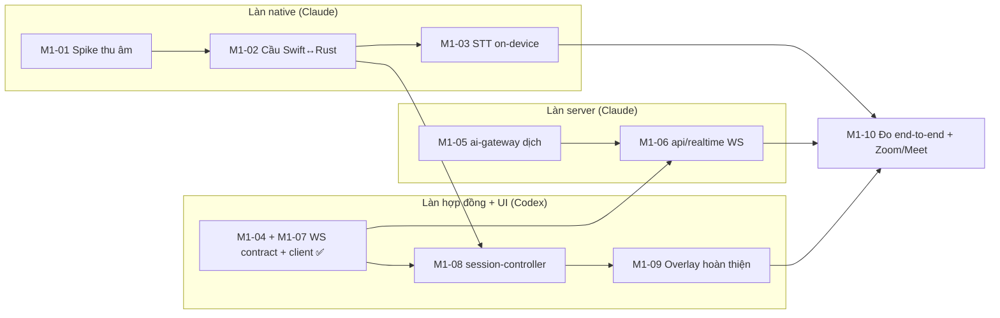

# Plan — M1 Caption sống

Backlog đầy đủ: [06-backlog.md](../../02-product/06-backlog.md). Trang này là kế hoạch thi công M1.

## Làn việc

## Tiến độ

| Task  | Chủ | Trạng thái       | Ghi chú                                                                                                                                                                                                                                                                                     |
| ----- | --- | ---------------- | ------------------------------------------------------------------------------------------------------------------------------------------------------------------------------------------------------------------------------------------------------------------------------------------- |
| M1-01 | C   | ✅               | Process Tap + mic chạy thật trên macOS 26: tín hiệu hệ thống rms 0,08–0,11, frame đầu sau ~110 ms (mic ~280 ms). Điều kiện: chạy trong **app bundle có `Info.plist`** (`NSAudioCaptureUsageDescription`, `NSMicrophoneUsageDescription`); CLI trần chạy dưới tiến trình khác nhận toàn số 0 |
| M1-04 | X   | ✅               | Hợp đồng `ws` trong `@cuelingo/shared`                                                                                                                                                                                                                                                      |
| M1-07 | X   | ✅               | Client realtime trong `@cuelingo/core-sdk` (đệm 60 s, backoff)                                                                                                                                                                                                                              |
| M1-05 | C   | ✅               | Prompt v1 + gateway + fallback; Gemini thật: `gemini-3.1-flash-lite` pass 12/12, p50 0,74 s, p95 0,97 s; dự phòng `gemini-3.5-flash-lite` (2.5 flash-lite Google đã ngừng cho tài khoản mới; 3.5 không nhận `thinkingBudget`, dùng `thinkingLevel: minimal`)                                |
| M1-02 | C   | ✅               | Sidecar Swift `cuelingo-audio` (JSON lines qua stdout, `stop` qua stdin) + `audio_bridge.rs` phát event `segment`/`audio-status`; `Info.plist` có quyền mic/system audio                                                                                                                    |
| M1-03 | C   | ✅ (chế độ file) | Parakeet TDT v2 + VAD năng lượng: câu mẫu 9 s nhận đúng (chỉ "SLA"→"slaw"), partial sau 0,7 s. Live chưa đo: cần bạn chạy app (quyền macOS mỗi lần ký lại)                                                                                                                                  |
| M1-06 | C+X | ✅               | WebSocket `/v1/sessions/:id/stream` (Codex) chạy thật với Gemini: ~0,8 s/câu, đúng thứ tự                                                                                                                                                                                                   |
| M1-08 | X   | ✅               | Session controller + chế độ demo                                                                                                                                                                                                                                                            |
| M1-09 | X   | ✅               | Overlay: toolbar cỡ chữ/sáng-tối, đồng bộ Assist level qua event `settings`                                                                                                                                                                                                                 |
| M1-10 | C   | cuối             | Cổng M1                                                                                                                                                                                                                                                                                     |

## Rủi ro

Xem [backlog](../../02-product/06-backlog.md#điều-chưa-chắc-và-cách-giảm-rủi-ro). Rủi ro hiện tại cao nhất: quyền macOS và STT streaming chưa đo.

## Số đo sơ bộ M1-10 (2026-11-01)

Đo bằng file ghi âm (giọng tổng hợp 5,6 s), chưa phải họp thật:

| Khâu                                      | Kết quả                       | Ngưỡng  |
| ----------------------------------------- | ----------------------------- | ------- |
| Nạp model (một lần)                       | ~0,3 s                        | -       |
| Partial đầu tiên                          | sau 0,7 s                     | -       |
| Nhận dạng câu cuối (5,6 s âm thanh)       | ~0,2 s sau khi chốt câu       | -       |
| Chốt câu (khoảng lặng 600 ms + nhận dạng) | ~0,8 s sau khi người nói xong | ≤ 1 s   |
| Dịch qua API + Gemini                     | 0,8–1,4 s mỗi câu             | -       |
| Ước tính tổng đến bản dịch                | ~1,6–2,2 s                    | ≤ 2,5 s |

Chưa đo: chạy live trong Zoom/Meet, ổn định 30 phút, overlay có lộ khi chia sẻ màn hình hay không.
