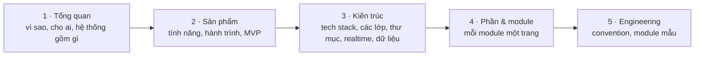

# Tài liệu CueLingo

CueLingo là trợ lý giao tiếp và học ngoại ngữ lấy AI làm trung tâm cho người đi làm: **giúp bạn hiểu và nói trong cuộc họp hôm nay, rồi dạy bạn để ngày mai cần hỗ trợ ít hơn.** Đây là nơi lưu toàn bộ tài liệu của phần mềm, đi từ bức tranh toàn cảnh xuống tới từng module.

## Đọc theo thứ tự nào

| Bạn là                       | Bắt đầu từ                                                                                                                             |
| ---------------------------- | -------------------------------------------------------------------------------------------------------------------------------------- |
| Người mới vào dự án          | [Bức tranh toàn cảnh](./01-overview/01-big-picture.md) → [Sơ đồ hệ thống](./01-overview/04-system-overview.md)                         |
| Product / thiết kế           | [Người dùng](./01-overview/03-users.md) → [Hành trình](./02-product/02-user-journeys.md) → [Phạm vi MVP](./02-product/03-mvp-scope.md) |
| Kỹ sư sắp code một module    | [Engineering](./05-engineering/README.md) → trang module trong [Phần & module](./04-modules/README.md)                                 |
| AI coding agent              | `AGENTS.md` ở gốc repo → [Extension points](./05-engineering/01-extension-points.md)                                                   |
| Người cần biết vì sao chọn X | [ADR](./08-adr/README.md) và [Nghiên cứu](./07-research/01-open-source.md)                                                             |

## Cấu trúc

| Mục                   | Nội dung                                                                                                                                |
| --------------------- | --------------------------------------------------------------------------------------------------------------------------------------- |
| **1 · Tổng quan**     | Bức tranh toàn cảnh, tầm nhìn, người dùng, sơ đồ hệ thống, thuật ngữ                                                                    |
| **2 · Sản phẩm**      | Bản đồ tính năng, hành trình người dùng, phạm vi MVP, lộ trình, mô hình kinh doanh                                                      |
| **3 · Kiến trúc**     | Tech stack, kiến trúc phần mềm, tổ chức thư mục, luồng realtime, Learner Model, kiến trúc AI, mô hình dữ liệu, bảo mật & quyền riêng tư |
| **4 · Phần & module** | Desktop, Web, API, Workers, Shared packages, ML — mỗi module một trang cùng khuôn                                                       |
| **5 · Engineering**   | Extension points, convention theo tầng, checklist review, viết tài liệu                                                                 |
| **6 · Delivery Log**  | Hồ sơ từng task: spec, plan, review                                                                                                     |
| **7 · Nghiên cứu**    | Khảo sát open source, benchmark STT + dịch                                                                                              |
| **8 · ADR**           | Các quyết định kiến trúc và lý do                                                                                                       |

## Quy ước

- Tài liệu viết bằng tiếng Việt; tên code, API, bảng, event giữ tiếng Anh.
- Đổi thiết kế một module → sửa trang module trong cùng commit với code.
- Quyết định khó đảo ngược → thêm ADR mới, không sửa ADR cũ.
- Cách viết trang mới: [Viết tài liệu](./05-engineering/conventions/writing-docs.md).
