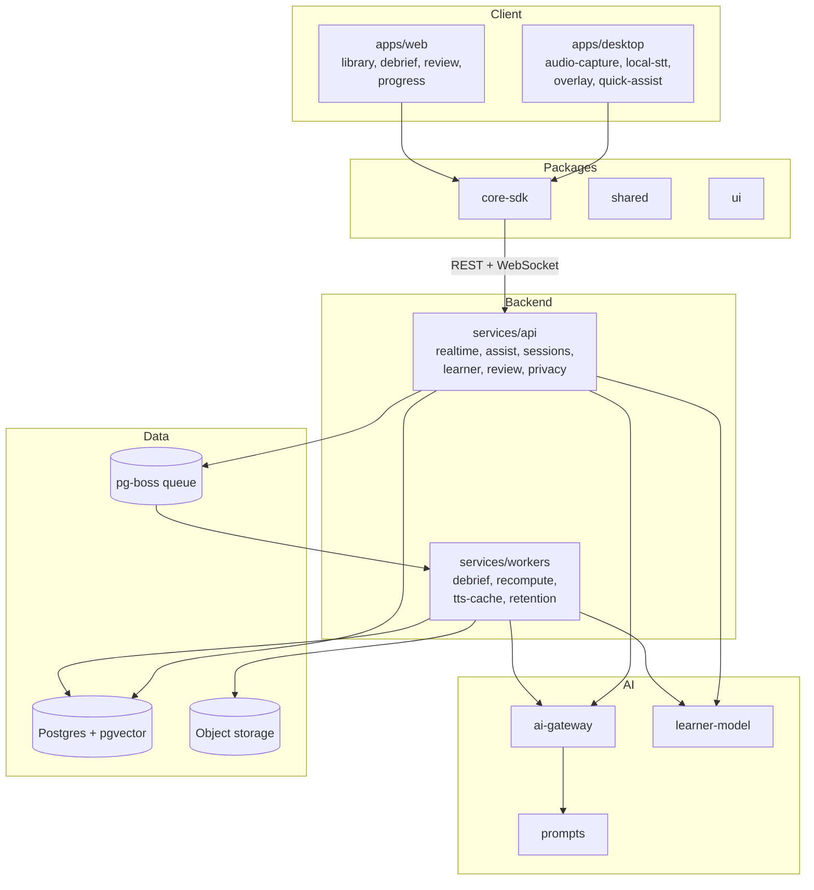

# Sơ đồ hệ thống

Hệ thống có 6 phần. Client (desktop, web) chỉ lo thu âm, hiển thị và cache. Logic học tập và AI nằm ở backend (API + workers) và trong các package dùng chung. Mọi phần cùng đọc và ghi vào một Learner Model.

## Các phần

| Phần | Vai trò | Tài liệu |
| --- | --- | --- |
| Desktop app | Bề mặt chính trong họp: thu âm 2 luồng, STT on-device, overlay caption, Quick Assist | [03-parts/desktop](../03-parts/desktop/README.md) |
| Web app | Xem lại, debrief, ôn tập, tiến bộ, quản lý dữ liệu | [03-parts/web](../03-parts/web/README.md) |
| API service | REST + WebSocket, dịch realtime, assist, Learner Model, ôn tập | [03-parts/api](../03-parts/api/README.md) |
| Workers | Debrief, tính lại Learner Model, TTS, dọn dữ liệu | [03-parts/workers](../03-parts/workers/README.md) |
| Shared packages | Kiểu, SDK, logic Learner Model, AI gateway, prompt, UI | [03-parts/packages](../03-parts/packages/README.md) |
| ML & evaluation | Benchmark và test hồi quy model/prompt | [03-parts/ml](../03-parts/ml/README.md) |

## Quy tắc phụ thuộc

- `apps/*` chỉ gọi backend qua `@cuelingo/core-sdk`. Không import code của `services/*`.
- `services/*` không import code của `apps/*`.
- `@cuelingo/learner-model` là logic thuần, không có I/O. API và workers lo đọc/ghi DB.
- Mọi lời gọi model AI đều đi qua `@cuelingo/ai-gateway`. Không gọi SDK của nhà cung cấp trực tiếp ở nơi khác.
- `@cuelingo/shared` không phụ thuộc vào package nội bộ nào khác.

## Luồng chính

1. **Trong họp**: [luồng realtime](../02-architecture/realtime-pipeline.md). Desktop thu âm, STT on-device, gửi câu final lên API; API dịch rồi trả về overlay.
2. **Sau họp**: API enqueue `debrief.generate` → worker tạo debrief → web/desktop hiển thị → người dùng thêm cụm từ vào ôn tập.
3. **Hằng ngày**: web lấy hàng đợi ôn tập; kết quả cập nhật FSRS và Learner Model.
