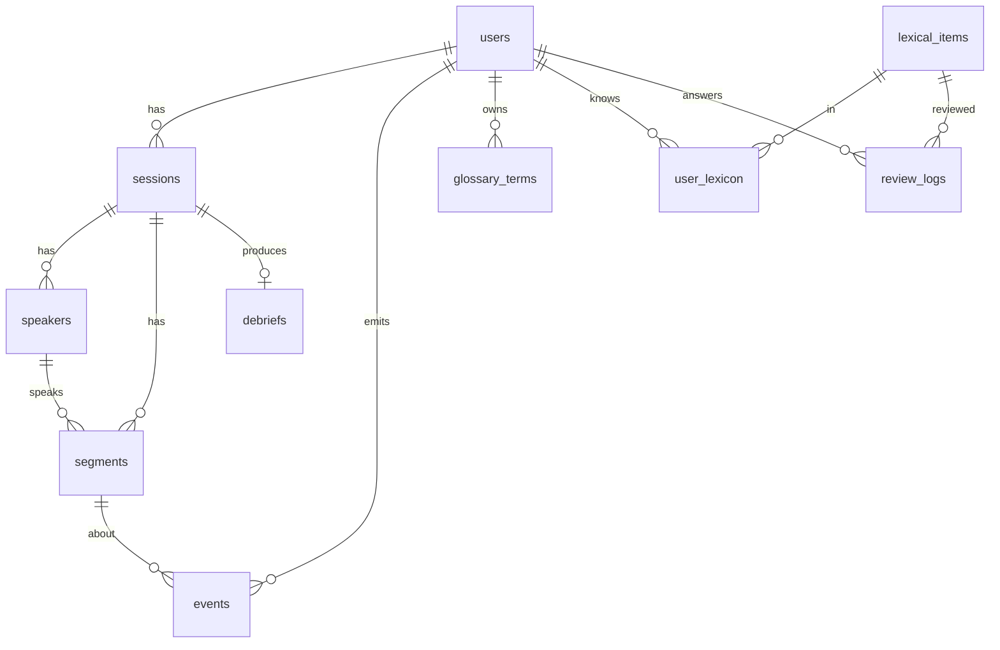

# Mô hình dữ liệu

Postgres 16 + pgvector là DB duy nhất của MVP. Bảng `events` (append-only) là nguồn sự thật cho Learner Model. `user_lexicon`, `comprehension_pct` và chỉ số tiến bộ là dữ liệu tính ra, có thể tính lại. Migration: [`infra/db/migrations/0001_init.sql`](../../infra/db/migrations/0001_init.sql).

| Bảng             | Vai trò                                                            | Module ghi                             |
| ---------------- | ------------------------------------------------------------------ | -------------------------------------- |
| `users`          | Profile, mức nghe, Assist mặc định, settings                       | api/auth, api/learner                  |
| `sessions`       | Một cuộc họp: thời gian, Assist level, nguồn STT, consent, chi phí | api/sessions                           |
| `speakers`       | Người nói trong phiên (`me`, `speaker_1`…)                         | api/realtime                           |
| `segments`       | Câu đã chốt: gốc, bản dịch, timestamp từng từ, embedding           | api/realtime                           |
| `events`         | Mọi tương tác, idempotent theo `id` do client sinh                 | api/events                             |
| `glossary_terms` | Thuật ngữ cá nhân                                                  | api/glossary                           |
| `lexical_items`  | Từ/cụm dùng chung                                                  | api/phrases-review                     |
| `user_lexicon`   | Trạng thái FSRS receptive/productive, giai đoạn, ngữ cảnh gốc      | api/learner, workers/learner-recompute |
| `debriefs`       | Kết quả debrief, có phiên bản và `prompt_version`                  | workers/debrief-job                    |
| `review_logs`    | Kết quả từng lần ôn                                                | api/phrases-review                     |

## Quy tắc

- Xoá `sessions` sẽ cascade sang `segments`, `speakers`, `events`, `debriefs`. `user_lexicon` giữ lại nhưng `first_context_segment_id` về NULL (thẻ còn, câu gốc mất), đúng yêu cầu US-15.
- Audio (nếu người dùng cho phép) lưu ở object storage theo `segments.audio_key`, tự xoá sau 30 ngày.
- `events.id` do client sinh (UUID v7) để gửi lại an toàn khi mất mạng.

## Catalog event (MVP)

`session_started` · `session_ended` · `segment_final` · `translation_shown` · `translation_expanded` · `lookup` · `ask_recap` · `compose_assist` · `phrase_saved` · `debrief_opened` · `debrief_feedback` · `review_session` · `review_answer` · `assist_level_changed` · `data_deleted` · `ai_call` (nội bộ)

Schema từng event: `@cuelingo/shared` (`events.ts`).
