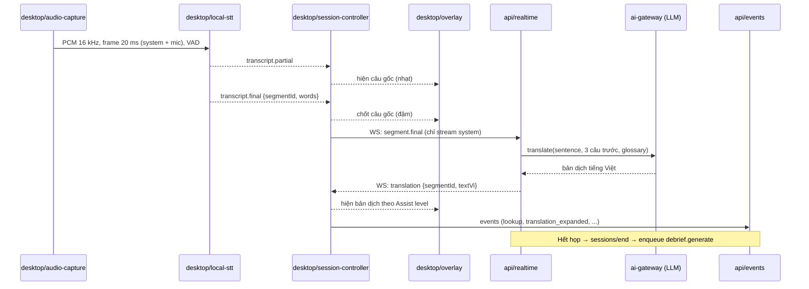

# Luồng realtime trong cuộc họp

Câu gốc hiện ngay từ STT on-device. Bản dịch theo sau từ API. Mọi tín hiệu học tập được ghi thành event để worker xử lý khi hết họp. Mục tiêu: câu gốc p95 ≤ 1 giây, bản dịch p95 ≤ 2,5 giây sau khi hết câu.

## Các bước

1. **Thu âm** ([audio-capture](../03-parts/desktop/audio-capture.md)): hai luồng tách biệt, `system` (người khác) và `mic` (người dùng). Silero VAD cắt đoạn có tiếng nói.
2. **STT on-device** ([local-stt](../03-parts/desktop/local-stt.md)): Parakeet-TDT 0.6B v3 qua FluidAudio, phát partial và final kèm timestamp từng từ. Chế độ cloud: client gửi audio frame lên `api/realtime`, và API gọi STT streaming qua `ai-gateway` ([ADR-0003](../adr/0003-stt-on-device-first.md)).
3. **Dịch** ([api/realtime](../03-parts/api/realtime.md)): chỉ dịch câu final của luồng `system`. Prompt gồm câu cần dịch, 3 câu trước và glossary. Model mặc định chốt sau khi so với LLM cloud ([ADR-0004](../adr/0004-translation-via-llm.md)).
4. **Hiển thị** ([overlay](../03-parts/desktop/overlay.md)): theo Assist level 4 / 3 / 1.
5. **Tín hiệu**: mọi thao tác (tra từ, mở bản dịch, recap, compose) được ghi thành event ([api/events](../03-parts/api/events.md)) và là đầu vào cho debrief và Learner Model.

## WebSocket protocol (tóm tắt)

Schema đầy đủ nằm trong `@cuelingo/shared` (`ws.ts`).

| Hướng           | Message                                   | Nội dung                                                         |
| --------------- | ----------------------------------------- | ---------------------------------------------------------------- |
| client → server | `hello`                                   | `{sessionId, token, sttSource: "local" \| "cloud", assistLevel}` |
| client → server | `segment.final`                           | `{segmentId, stream, startMs, endMs, text, words[]}` (STT local) |
| client → server | `audio`                                   | binary PCM frame (STT cloud)                                     |
| client → server | `event`                                   | event học tập, gửi theo batch                                    |
| server → client | `transcript.partial` / `transcript.final` | chỉ khi dùng STT cloud                                           |
| server → client | `translation`                             | `{segmentId, textVi, hardWords[]}`                               |
| server → client | `error`                                   | `{code, retryable}`                                              |

## Ngân sách độ trễ (ước tính từ benchmark)

| Bước                      | Ước tính              | Nguồn                                                             |
| ------------------------- | --------------------- | ----------------------------------------------------------------- |
| STT final sau khi hết câu | ~0,3–0,6 s            | Parakeet, ~3 s xử lý / phút audio trên M1 Pro (chưa đo streaming) |
| Mạng client ↔ API         | ~0,05–0,15 s          | region châu Á                                                     |
| Dịch 1 câu                | p50 0,8 s · p95 1,5 s | TranslateGemma 4B / Qwen3-4B local; LLM cloud cần đo              |
| **Tổng**                  | **~1,2–2,2 s**        | chưa đo end-to-end                                                |

## Lỗi và phục hồi

- Mất mạng: hiện cảnh báo trên overlay, `core-sdk` đệm tối đa 60 giây rồi gửi lại. STT local vẫn chạy nên câu gốc không bị gián đoạn.
- LLM chậm hoặc lỗi: `ai-gateway` timeout ở 3 giây rồi chuyển sang model dự phòng; vẫn quá hạn thì bỏ bản dịch câu đó (câu gốc vẫn hiện).
- Người nói chen tiếng Việt: hiện nguyên văn, không dịch.
